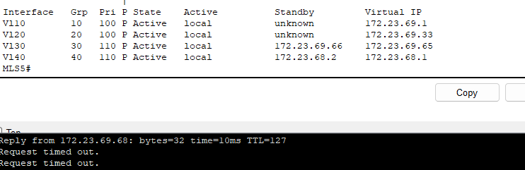

# Sprint 1

## M1B - Team 3

| Name                  | Student Number | Role / Site Responsibility |
| --------------------- | -------------- | -------------------------- |
|                       |                | *Oporto (HQ)*              |
| *João Fernandes*      | *1211681*      | *Warsaw (BR1)*             |
|                       |                | *Munich (BR2)*             |
| *Francisco Magalhães* | *1170589*      | *The Vault*                |

## General Configuration

- All unused switch ports are assigned to VLAN 99 and administratively shutdown;

---

## 1. Oporto (HQ)

### <u>**Assigned address space:**</u> 10.42.56.0/22

### 1.1 Network Addressing Table

| Network             | Hosts req. | CIDR | Mask            | Network Address | Broadcast Address | First Host   | Last Host    |
| ------------------- | ---------- | ---- | --------------- | --------------- | ----------------- | ------------ | ------------ |
| VLAN40 – USERS      | 500        | /23  | 255.255.254.0   | 10.42.56.0      | 10.42.57.255      | 10.42.56.1   | 10.42.57.254 |
| VLAN20 – ACCOUNTING | 200        | /24  | 255.255.255.0   | 10.42.58.0      | 10.42.58.255      | 10.42.58.1   | 10.42.58.254 |
| VLAN30 – HR         | 100        | /25  | 255.255.255.128 | 10.42.59.0      | 10.42.59.127      | 10.42.59.1   | 10.42.59.126 |
| VLAN10 – STAFF      | 50         | /26  | 255.255.255.192 | 10.42.59.128    | 10.42.59.191      | 10.42.59.129 | 10.42.59.190 |
| HQ ↔ MLS1           | 2          | /30  | 255.255.255.252 | 10.42.59.192    | 10.42.59.195      | 10.42.59.193 | 10.42.59.194 |
| HQ ↔ MLS2           | 2          | /30  | 255.255.255.252 | 10.42.59.196    | 10.42.59.199      | 10.42.59.197 | 10.42.59.198 |

### 1.2 Interface Addressing Table

#### 1.2.1 HQ (Oporto)

| Interface | Assigned IP   | Subnet Mask | Purpose                  |
| --------- | ------------- | ----------- | ------------------------ |
| Gig0/0    | 10.42.59.193  | /30         | Link to MLS1             |
| Gig0/1    | 10.42.59.197  | /30         | Link to MLS2             |
| Gig0/0/0  | DHCP-assigned | /27         | Internet (SP) connection |

#### 1.2.2 MLS1

| Interface | Assigned IP  | Subnet Mask | Purpose             |
| --------- | ------------ | ----------- | ------------------- |
| Gig0/1    | 10.42.59.194 | /30         | Link to HQ (Oporto) |
| Fa0/1     | —            | —           |                     |
| Fa0/2     | —            | —           |                     |
| Fa0/3     | —            | —           |                     |
| Fa0/4     | —            | —           |                     |

#### 1.2.3 MLS2

| Interface | Assigned IP  | Subnet Mask | Purpose             |
| --------- | ------------ | ----------- | ------------------- |
| Gig0/1    | 10.42.59.198 | /30         | Link to HQ (Oporto) |
| Fa0/1     | —            | —           |                     |
| Fa0/2     | —            | —           |                     |
| Fa0/3     | —            | —           |                     |
| Fa0/4     | —            | —           |                     |

#### 1.2.4 SW1

| Interface | Purpose |
| --------- | ------- |
|           |         |
|           |         |
| Fa0/3     |         |
| Fa0/4     |         |

#### 1.2.5 SW2

| Interface | Purpose |
| --------- | ------- |
|           |         |
|           |         |
| Fa0/3     |         |
| Fa0/4     |         |

#### 1.2.6 Oporto-STAFF

| Interface | Assigned IP   | Subnet Mask | Purpose     |
| --------- | ------------- | ----------- | ----------- |
| Fa0       | DHCP-assigned | /26         | VLAN10 host |

#### 1.2.7 Oporto-ACCOUNTING

| Interface | Assigned IP   | Subnet Mask | Purpose     |
| --------- | ------------- | ----------- | ----------- |
| Fa0       | DHCP-assigned | /24         | VLAN20 host |

#### 1.2.8 Oporto-HR

| Interface | Assigned IP   | Subnet Mask | Purpose     |
| --------- | ------------- | ----------- | ----------- |
| Fa0       | DHCP-assigned | /25         | VLAN30 host |

#### 1.2.9 Oporto-USERS

| Interface | Assigned IP   | Subnet Mask | Purpose     |
| --------- | ------------- | ----------- | ----------- |
| Fa0       | DHCP-assigned | /23         | VLAN40 host |

### 1.3 Connectivity Tests

| Source        | Destination        | Test Type | Result  |
| ------------- | ------------------ | --------- | ------- |
| HQ Router     | SP gateway         | `ping`    | Success |
| HQ Router     | www.google.com     | `ping`    | Success |
| HQ PC (STAFF) | HQ PC (ACCOUNTING) | `ping`    | Success |
| HQ PC (STAFF) | HQ PC (HR)         | `ping`    | Success |
| HQ PC (STAFF) | HQ PC (USERS)      | `ping`    | Success |

---

## 2. Warsaw (BR1)

### <u>**Assigned address space:**</u> 172.23.68.0/23

### 2.1 Network Addressing Table

| Network             | Hosts req. | CIDR | Mask            | Network Address | Broadcast Address | First Host   | Last Host     |
| ------------------- | ---------- | ---- | --------------- | --------------- | ----------------- | ------------ | ------------- |
| VLAN40 – USERS      | 200        | /24  | 255.255.255.0   | 172.23.68.0     | 172.23.68.255     | 172.23.68.1  | 172.23.68.254 |
| VLAN10 – STAFF      | 30         | /27  | 255.255.255.224 | 172.23.69.0     | 172.23.69.31      | 172.23.69.1  | 172.23.69.30  |
| VLAN20 – ACCOUNTING | 20         | /27  | 255.255.255.224 | 172.23.69.32    | 172.23.69.63      | 172.23.69.33 | 172.23.69.62  |
| VLAN30 – HR         | 10         | /28  | 255.255.255.240 | 172.23.69.64    | 172.23.69.79      | 172.23.69.65 | 172.23.69.78  |
| MLS3 ↔ BR1          | 2          | /30  | 255.255.255.252 | 172.23.69.80    | 172.23.69.83      | 172.23.69.81 | 172.23.69.82  |
| MLS3 ↔ MLS4         | 2          | /30  | 255.255.255.252 | 172.23.69.84    | 172.23.69.87      | 172.23.69.85 | 172.23.69.86  |
| MLS3 ↔ MLS5         | 2          | /30  | 255.255.255.252 | 172.23.69.88    | 172.23.69.91      | 172.23.69.89 | 172.23.69.90  |

The `172.23.68.0/23` block was divided with VLSM, starting with the largest network: USERS uses a /24, STAFF and ACCOUNTING a /27 each, HR a /28 and each point-to-point link a /30. The networks do not overlap, and `172.23.69.92–172.23.69.255` is left free for the next sprints.

### 2.2 Interface Addressing Table

The tables list only the interfaces in use. On every switch, all other ports are unused: they are assigned to VLAN 99 (BLACKHOLE) and administratively shut down. On BR1, Gig0/1 is not used and is also shut down.

#### 2.2.1 BR1 (Warsaw)

| Interface | Assigned IP                | Subnet Mask | Purpose                                        |
| --------- | -------------------------- | ----------- | ---------------------------------------------- |
| Gig0/0    | 172.23.69.82               | /30         | Link to MLS3 (Gig0/1)                          |
| Gig0/0/0  | DHCP-assigned (192.0.2.97) | /28         | Internet (SP) connection — gateway 192.0.2.110 |

BR1 connects Warsaw to the Internet. Gig0/0 goes to MLS3, Gig0/0/0 gets its address, gateway and DNS server from the service provider through DHCP, and Gig0/1 is not used.

**Verification:** `show ip interface brief` shows Gig0/0 with 172.23.69.82, Gig0/0/0 with 192.0.2.97 (method DHCP).

#### 2.2.2 MLS3

| Interface | Assigned IP  | Subnet Mask | Purpose                                                                       |
| --------- | ------------ | ----------- | ----------------------------------------------------------------------------- |
| Gig0/1    | 172.23.69.81 | /30         | Routed port — link to BR1 (Warsaw) Gig0/0                                     |
| VLAN100   | 172.23.69.85 | /30         | Transit SVI — Layer 3 link to MLS4                                            |
| VLAN101   | 172.23.69.89 | /30         | Transit SVI — Layer 3 link to MLS5                                            |
| Po1       | —            | —           | LACP EtherChannel to MLS4 — 802.1Q trunk, native VLAN 50, all VLANs except 99 |
| Fa0/1     | —            | —           | Po1 member — to MLS4 Fa0/1                                                    |
| Fa0/2     | —            | —           | Po1 member — to MLS4 Fa0/2                                                    |
| Po2       | —            | —           | LACP EtherChannel to MLS5 — 802.1Q trunk, native VLAN 50, all VLANs except 99 |
| Fa0/3     | —            | —           | Po2 member — to MLS5 Fa0/3                                                    |
| Fa0/4     | —            | —           | Po2 member — to MLS5 Fa0/4                                                    |

MLS3 links the two distribution switches to BR1. Its link to BR1 is a routed port, and its links to MLS4 and MLS5 are EtherChannels with a Layer 3 address on VLAN 100 and VLAN 101.

**Verification:** `show ip interface brief` shows Gig0/1, Vlan100 and Vlan101 up with their addresses and the unused ports administratively down.

#### 2.2.3 MLS4

| Interface | Assigned IP  | Subnet Mask | Purpose                                                                       |
| --------- | ------------ | ----------- | ----------------------------------------------------------------------------- |
| VLAN10    | 172.23.69.2  | /27         | STAFF SVI — HSRP group 10, **active** (virtual IP 172.23.69.1)                |
| VLAN20    | 172.23.69.34 | /27         | ACCOUNTING SVI — HSRP group 20, **active** (virtual IP 172.23.69.33)          |
| VLAN30    | 172.23.69.66 | /28         | HR SVI — HSRP group 30, standby (virtual IP 172.23.69.65)                     |
| VLAN40    | 172.23.68.2  | /24         | USERS SVI — HSRP group 40, standby (virtual IP 172.23.68.1)                   |
| VLAN100   | 172.23.69.86 | /30         | Transit SVI — Layer 3 link to MLS3                                            |
| Po1       | —            | —           | LACP EtherChannel to MLS3 — 802.1Q trunk, native VLAN 50, all VLANs except 99 |
| Fa0/1     | —            | —           | Po1 member — to MLS3 Fa0/1                                                    |
| Fa0/2     | —            | —           | Po1 member — to MLS3 Fa0/2                                                    |
| Po3       | —            | —           | LACP EtherChannel to MLS5 — 802.1Q trunk, native VLAN 50, all VLANs except 99 |
| Fa0/3     | —            | —           | Po3 member — to MLS5 Fa0/1                                                    |
| Fa0/4     | —            | —           | Po3 member — to MLS5 Fa0/2                                                    |
| Fa0/5     | —            | —           | Trunk to SW3 Fa0/1                                                            |
| Fa0/6     | —            | —           | Trunk to SW4 Fa0/1                                                            |
| Fa0/7     | —            | —           | Trunk to SW5 Fa0/1                                                            |
| Fa0/8     | —            | —           | Trunk to SW6 Fa0/1                                                            |

MLS4 is one of the two gateways of the user networks. It has an interface in each user VLAN with the second address of the network; the first address is the gateway shared with MLS5 through HSRP. It connects to MLS3, to MLS5 and to the four access switches.

**Verification:** `show ip interface brief` shows the five SVIs up with the addresses in the table and the unused ports administratively down.

#### 2.2.4 MLS5

| Interface | Assigned IP  | Subnet Mask | Purpose                                                                       |
| --------- | ------------ | ----------- | ----------------------------------------------------------------------------- |
| VLAN10    | 172.23.69.3  | /27         | STAFF SVI — HSRP group 10, standby (virtual IP 172.23.69.1)                   |
| VLAN20    | 172.23.69.35 | /27         | ACCOUNTING SVI — HSRP group 20, standby (virtual IP 172.23.69.33)             |
| VLAN30    | 172.23.69.67 | /28         | HR SVI — HSRP group 30, **active** (virtual IP 172.23.69.65)                  |
| VLAN40    | 172.23.68.3  | /24         | USERS SVI — HSRP group 40, **active** (virtual IP 172.23.68.1)                |
| VLAN101   | 172.23.69.90 | /30         | Transit SVI — Layer 3 link to MLS3                                            |
| Po3       | —            | —           | LACP EtherChannel to MLS4 — 802.1Q trunk, native VLAN 50, all VLANs except 99 |
| Fa0/1     | —            | —           | Po3 member — to MLS4 Fa0/3                                                    |
| Fa0/2     | —            | —           | Po3 member — to MLS4 Fa0/4                                                    |
| Po2       | —            | —           | LACP EtherChannel to MLS3 — 802.1Q trunk, native VLAN 50, all VLANs except 99 |
| Fa0/3     | —            | —           | Po2 member — to MLS3 Fa0/3                                                    |
| Fa0/4     | —            | —           | Po2 member — to MLS3 Fa0/4                                                    |
| Fa0/5     | —            | —           | Trunk to SW3 Fa0/2                                                            |
| Fa0/6     | —            | —           | Trunk to SW4 Fa0/2                                                            |
| Fa0/7     | —            | —           | Trunk to SW5 Fa0/2                                                            |
| Fa0/8     | —            | —           | Trunk to SW6 Fa0/2                                                            |

MLS5 is the second gateway of the user networks and mirrors MLS4, using the third address of each user network.

**Verification:** `show ip interface brief` shows the five SVIs up with the addresses in the table and the unused ports administratively down.

#### 2.2.5 SW3

| Interface     | Assigned IP | Subnet Mask | Purpose                                                      |
| ------------- | ----------- | ----------- | ------------------------------------------------------------ |
| Fa0/1         | —           | —           | Trunk to MLS4 Fa0/5 — native VLAN 50, all VLANs except 99    |
| Fa0/2         | —           | —           | Trunk to MLS5 Fa0/5 — native VLAN 50, all VLANs except 99    |
| Fa0/3–Fa0/5   | —           | —           | Access — VLAN 10 (STAFF), PortFast; Warsaw-STAFF PC on Fa0/3 |
| Fa0/6–Fa0/10  | —           | —           | Access — VLAN 20 (ACCOUNTING), PortFast                      |
| Fa0/11–Fa0/15 | —           | —           | Access — VLAN 30 (HR), PortFast                              |
| Fa0/16–Fa0/20 | —           | —           | Access — VLAN 40 (USERS), PortFast                           |

SW3 is an access switch with one uplink to MLS4 and one to MLS5, so it stays connected if one of them fails. The access ports are assigned to the four user VLANs. SW4, SW5 and SW6 have the same configuration.

**Verification:** `show vlan brief` shows each group of access ports in its VLAN and the unused ports in VLAN 99.

#### 2.2.6 SW4

| Interface     | Assigned IP | Subnet Mask | Purpose                                                                |
| ------------- | ----------- | ----------- | ---------------------------------------------------------------------- |
| Fa0/1         | —           | —           | Trunk to MLS4 Fa0/6 — native VLAN 50, all VLANs except 99              |
| Fa0/2         | —           | —           | Trunk to MLS5 Fa0/6 — native VLAN 50, all VLANs except 99              |
| Fa0/3–Fa0/5   | —           | —           | Access — VLAN 10 (STAFF), PortFast                                     |
| Fa0/6–Fa0/10  | —           | —           | Access — VLAN 20 (ACCOUNTING), PortFast; Warsaw-ACCOUNTING PC on Fa0/6 |
| Fa0/11–Fa0/15 | —           | —           | Access — VLAN 30 (HR), PortFast                                        |
| Fa0/16–Fa0/20 | —           | —           | Access — VLAN 40 (USERS), PortFast                                     |

Same configuration as SW3. The Warsaw-ACCOUNTING PC is on Fa0/6.

**Verification:** `show vlan brief` shows the same port assignment as SW3.

#### 2.2.7 SW5

| Interface     | Assigned IP | Subnet Mask | Purpose                                                   |
| ------------- | ----------- | ----------- | --------------------------------------------------------- |
| Fa0/1         | —           | —           | Trunk to MLS4 Fa0/7 — native VLAN 50, all VLANs except 99 |
| Fa0/2         | —           | —           | Trunk to MLS5 Fa0/7 — native VLAN 50, all VLANs except 99 |
| Fa0/3–Fa0/5   | —           | —           | Access — VLAN 10 (STAFF), PortFast                        |
| Fa0/6–Fa0/10  | —           | —           | Access — VLAN 20 (ACCOUNTING), PortFast                   |
| Fa0/11–Fa0/15 | —           | —           | Access — VLAN 30 (HR), PortFast; Warsaw-HR PC on Fa0/11   |
| Fa0/16–Fa0/20 | —           | —           | Access — VLAN 40 (USERS), PortFast                        |

Same configuration as SW3. The Warsaw-HR PC is on Fa0/11.

**Verification:** `show vlan brief` shows the same port assignment as SW3.

#### 2.2.8 SW6

| Interface     | Assigned IP | Subnet Mask | Purpose                                                       |
| ------------- | ----------- | ----------- | ------------------------------------------------------------- |
| Fa0/1         | —           | —           | Trunk to MLS4 Fa0/8 — native VLAN 50, all VLANs except 99     |
| Fa0/2         | —           | —           | Trunk to MLS5 Fa0/8 — native VLAN 50, all VLANs except 99     |
| Fa0/3–Fa0/5   | —           | —           | Access — VLAN 10 (STAFF), PortFast                            |
| Fa0/6–Fa0/10  | —           | —           | Access — VLAN 20 (ACCOUNTING), PortFast                       |
| Fa0/11–Fa0/15 | —           | —           | Access — VLAN 30 (HR), PortFast                               |
| Fa0/16–Fa0/20 | —           | —           | Access — VLAN 40 (USERS), PortFast; Warsaw-USERS PC on Fa0/16 |

Same configuration as SW3. The Warsaw-USERS PC is on Fa0/16.

**Verification:** `show vlan brief` shows the same port assignment as SW3.

#### 2.2.9 Warsaw-STAFF

| Interface | Assigned IP                 | Subnet Mask | Purpose                                  |
| --------- | --------------------------- | ----------- | ---------------------------------------- |
| Fa0       | DHCP-assigned (172.23.69.4) | /27         | VLAN10 host — gateway 172.23.69.1 (HSRP) |

The PC gets its configuration by DHCP from MLS4.

**Verification:** `ipconfig /all` (shown in 2.3.6).

#### 2.2.10 Warsaw-ACCOUNTING

| Interface | Assigned IP                  | Subnet Mask | Purpose                                   |
| --------- | ---------------------------- | ----------- | ----------------------------------------- |
| Fa0       | DHCP-assigned (172.23.69.36) | /27         | VLAN20 host — gateway 172.23.69.33 (HSRP) |

The PC gets its configuration by DHCP from MLS4.

**Verification:** `ipconfig /all`.

#### 2.2.11 Warsaw-HR

| Interface | Assigned IP                  | Subnet Mask | Purpose                                   |
| --------- | ---------------------------- | ----------- | ----------------------------------------- |
| Fa0       | DHCP-assigned (172.23.69.68) | /28         | VLAN30 host — gateway 172.23.69.65 (HSRP) |

The PC gets its configuration by DHCP from MLS5.

**Verification:** `ipconfig /all`.

#### 2.2.12 Warsaw-USERS

| Interface | Assigned IP                 | Subnet Mask | Purpose                                  |
| --------- | --------------------------- | ----------- | ---------------------------------------- |
| Fa0       | DHCP-assigned (172.23.68.4) | /24         | VLAN40 host — gateway 172.23.68.1 (HSRP) |

The PC gets its configuration by DHCP from MLS5.

**Verification:** `ipconfig /all`.

### 2.3 Configuration Decisions

#### 2.3.1 Addressing

- **VLSM, largest network first:** All Warsaw networks fit inside `172.23.68.0/23`. The range `172.23.69.92–172.23.69.255` is left free for later sprints.
- **Network sizes:** USERS (200) uses a /24, STAFF (30) and ACCOUNTING (20) a /27, HR (10) a /28 and the point-to-point links a /30.

#### 2.3.2 VLANs and VTP

- **VTP domain** `RECOMP2627M1B03`, password `7262pmocer`. MLS3, MLS4 and MLS5 are VTP servers; SW3–SW6 are VTP clients.
- **VLANs are created only on MLS4** and reach the other switches through VTP.

| VLAN | Name              | Use                                    |
| ---- | ----------------- | -------------------------------------- |
| 10   | STAFF             | User network                           |
| 20   | ACCOUNTING        | User network                           |
| 30   | HR                | User network                           |
| 40   | USERS             | User network                           |
| 50   | NATIVE            | Native VLAN on every trunk             |
| 99   | BLACKHOLE         | Unused ports; not allowed on any trunk |
| 100  | TRANSIT-MLS3-MLS4 | Layer 3 transit between MLS3 and MLS4  |
| 101  | TRANSIT-MLS3-MLS5 | Layer 3 transit between MLS3 and MLS5  |

VTP keeps the same list of VLANs on every Warsaw switch. The VLANs were created once on MLS4 and the other switches received them automatically: MLS3 and MLS5 as servers and the four access switches as clients.

**Verification:** `show vtp status` shows the same domain, revision and MD5 digest on every switch, with Server mode on MLS3–MLS5 and Client mode on SW3–SW6.

**MLS4 – `show vtp status` (server)**

**SW3 – `show vtp status` (client with the same revision and MD5 digest)**

#### 2.3.3 Interconnection between MLS3, MLS4 and MLS5

- **Layer 2:** MLS3, MLS4 and MLS5 are connected to each other by three LACP EtherChannels, configured as 802.1Q trunks (native VLAN 50, all VLANs except 99).
- **Layer 3:** MLS3 reaches MLS4 through VLAN 100 and MLS5 through VLAN 101. Each of these VLANs has a /30 network and an SVI on both ends, so MLS3 routes to MLS4 and MLS5 over the EtherChannels.

| Port-channel | Between     | Ports                       | Protocol |
| ------------ | ----------- | --------------------------- | -------- |
| Po1          | MLS3 ↔ MLS4 | MLS3 Fa0/1–2 ↔ MLS4 Fa0/1–2 | LACP     |
| Po2          | MLS3 ↔ MLS5 | MLS3 Fa0/3–4 ↔ MLS5 Fa0/3–4 | LACP     |
| Po3          | MLS4 ↔ MLS5 | MLS4 Fa0/3–4 ↔ MLS5 Fa0/1–2 | LACP     |

Each EtherChannel joins two cables into one logical link. This doubles the bandwidth, keeps the link working if one cable fails, and lets Spanning Tree treat the two cables as a single link.

**Verification:** `show etherchannel summary` shows every Port-channel in use (SU) with LACP and both ports bundled (P). `show interfaces trunk` shows native VLAN 50 and VLAN 99 not allowed. A ping from MLS3 to 172.23.69.86 and 172.23.69.90 confirms the Layer 3 links.

**MLS4 – `show etherchannel summary` (Po1 and Po3)**

**MLS5 – `show etherchannel summary` (Po2 and Po3)**

#### 2.3.4 Rapid-PVST+ and HSRP

- **Rapid-PVST+** runs on every switch. The HSRP active switch of each VLAN is the STP root of that VLAN, as required.
- **HSRP:** Each user VLAN has its own HSRP group, numbered like the VLAN; the active switch has priority 110 and both switches use `preempt`, so the active role returns after a failure.
- **MLS3 keeps the default STP priority** and is never root for VLANs 10–40, 100 and 101.
- **Access ports use PortFast**, so hosts get their DHCP lease without waiting for STP.

| VLAN | STP root (primary) | STP secondary root | HSRP active | Virtual IP   |
| ---- | ------------------ | ------------------ | ----------- | ------------ |
| 10   | MLS4               | MLS5               | MLS4        | 172.23.69.1  |
| 20   | MLS4               | MLS5               | MLS4        | 172.23.69.33 |
| 30   | MLS5               | MLS4               | MLS5        | 172.23.69.65 |
| 40   | MLS5               | MLS4               | MLS5        | 172.23.68.1  |
| 100  | MLS4               | —                  | —           | —            |
| 101  | MLS5               | —                  | —           | —            |

**Rapid-PVST+.** Each access switch is connected to both MLS4 and MLS5, which creates loops. Rapid-PVST+ blocks the extra path in each VLAN and opens it again in one or two seconds if the active path fails. Because MLS4 is the root for VLANs 10 and 20 and MLS5 for VLANs 30 and 40, both uplinks of every access switch are used.

**Verification:** `show spanning-tree vlan 10` on MLS4 and `show spanning-tree vlan 30` on MLS5 show *"This bridge is the root"*.

**MLS4 – `show spanning-tree vlan 10` (root)**

**MLS5 – `show spanning-tree vlan 30` (root)**

**HSRP.** MLS4 and MLS5 share a virtual IP address in each user VLAN, and the PCs use it as their default gateway. One switch is active and answers for that address; the other is standby and takes over if the active one fails, so the PCs keep working with the same gateway. When the failed switch comes back, it becomes active again.

**Verification:** `show standby brief` on MLS4 shows VLANs 10 and 20 as Active and VLANs 30 and 40 as Standby. The failover test in 2.4 shows MLS5 taking over when MLS4 is isolated.

**MLS4 – `show standby brief` (MLS4 active for VLANs 10 and 20, MLS5 active for VLANs 30 and 40)**

#### 2.3.5 Routing

`ip routing` is enabled on MLS3, MLS4 and MLS5. All routes are static.

| Device | Destination    | Next hop                      | Notes                               |
| ------ | -------------- | ----------------------------- | ----------------------------------- |
| MLS4   | 0.0.0.0/0      | 172.23.69.85 (MLS3)           | Default route                       |
| MLS5   | 0.0.0.0/0      | 172.23.69.89 (MLS3)           | Default route                       |
| MLS3   | 172.23.68.0/23 | 172.23.69.86 and 172.23.69.90 | Equal-cost routes via MLS4 and MLS5 |
| MLS3   | 0.0.0.0/0      | 172.23.69.82 (BR1)            | Default route                       |
| BR1    | 172.23.68.0/23 | 172.23.69.81 (MLS3)           | Return route to the Warsaw networks |
| BR1    | 0.0.0.0/0      | 192.0.2.110 (SP)              | Learned from the SP through DHCP    |

MLS4 and MLS5 route between the user VLANs and send all other traffic to MLS3. MLS3 reaches the user networks through both MLS4 and MLS5 and sends the rest to BR1. BR1 sends the traffic for Warsaw back to MLS3 and uses the default route received from the service provider for everything else.

**Verification:** `show ip route` on MLS3 shows the two routes to `172.23.68.0/23` and the default route to BR1; on BR1 it shows the route to Warsaw and the default route learned from the service provider.

**MLS3 – `show ip route`**

**BR1 – `show ip route`**

#### 2.3.6 DHCP

Identical pools on MLS4 and MLS5. Every pool uses DNS server `8.8.8.8` and domain `RECOMP2627M1B03.recomp.com`.

| Pool       | Network         | Default gateway (HSRP) | Excluded                  |
| ---------- | --------------- | ---------------------- | ------------------------- |
| STAFF      | 172.23.69.0/27  | 172.23.69.1            | 172.23.69.1–172.23.69.3   |
| ACCOUNTING | 172.23.69.32/27 | 172.23.69.33           | 172.23.69.33–172.23.69.35 |
| HR         | 172.23.69.64/28 | 172.23.69.65           | 172.23.69.65–172.23.69.67 |
| USERS      | 172.23.68.0/24  | 172.23.68.1            | 172.23.68.1–172.23.68.3   |

Each PC receives an address from its VLAN, the HSRP virtual IP as default gateway, DNS server 8.8.8.8 and the domain of the group. The gateway and switch addresses are excluded from the pools. Because MLS4 and MLS5 have the same pools, the PCs still get an address if one of them fails.

**Verification:** `ipconfig /all` on each PC shows the address, the gateway, the DNS server and the domain. `show ip dhcp binding` on MLS4 and MLS5 lists the addresses given to the PCs.

**Warsaw-STAFF – `ipconfig /all`**

### 2.4 Connectivity Tests

| Source                        | Destination                           | Test Type                       | Result                                               |
| ----------------------------- | ------------------------------------- | ------------------------------- | ---------------------------------------------------- |
| BR1 Router                    | SP gateway (192.0.2.110)              | `ping`                          | Success                                              |
| BR1 Router                    | www.google.com                        | `ping`                          | Success                                              |
| Warsaw PC (STAFF)             | Warsaw PC (ACCOUNTING) — 172.23.69.36 | `ping`                          | Success                                              |
| Warsaw PC (STAFF)             | Warsaw PC (HR) — 172.23.69.68         | `ping`                          | Success                                              |
| Warsaw PC (STAFF)             | Warsaw PC (USERS) — 172.23.68.4       | `ping`                          | Success                                              |
| Warsaw PC (STAFF)             | BR1 Gig0/0 (172.23.69.82)             | `ping`                          | Success                                              |
| Warsaw PC (STAFF)             | Warsaw PC (HR) — 172.23.69.68         | `tracert`                       | Success — first hop 172.23.69.2 (MLS4, HSRP active)  |
| Warsaw PC (ACCOUNTING)        | Warsaw PC (STAFF) — 172.23.69.4       | `ping`                          | Success                                              |
| Warsaw PC (ACCOUNTING)        | Warsaw PC (HR) — 172.23.69.68         | `ping`                          | Success                                              |
| Warsaw PC (ACCOUNTING)        | Warsaw PC (USERS) — 172.23.68.4       | `ping`                          | Success                                              |
| Warsaw PC (ACCOUNTING)        | BR1 Gig0/0 (172.23.69.82)             | `ping`                          | Success                                              |
| Warsaw PC (ACCOUNTING)        | Warsaw PC (USERS) — 172.23.68.4       | `tracert`                       | Success — first hop 172.23.69.34 (MLS4, HSRP active) |
| Warsaw PC (HR)                | Warsaw PC (STAFF) — 172.23.69.4       | `ping`                          | Success                                              |
| Warsaw PC (HR)                | Warsaw PC (ACCOUNTING) — 172.23.69.36 | `ping`                          | Success                                              |
| Warsaw PC (HR)                | Warsaw PC (USERS) — 172.23.68.4       | `ping`                          | Success                                              |
| Warsaw PC (HR)                | BR1 Gig0/0 (172.23.69.82)             | `ping`                          | Success                                              |
| Warsaw PC (HR)                | Warsaw PC (STAFF) — 172.23.69.4       | `tracert`                       | Success — first hop 172.23.69.67 (MLS5, HSRP active) |
| Warsaw PC (USERS)             | Warsaw PC (STAFF) — 172.23.69.4       | `ping`                          | Success                                              |
| Warsaw PC (USERS)             | Warsaw PC (ACCOUNTING) — 172.23.69.36 | `ping`                          | Success                                              |
| Warsaw PC (USERS)             | Warsaw PC (HR) — 172.23.69.68         | `ping`                          | Success                                              |
| Warsaw PC (USERS)             | BR1 Gig0/0 (172.23.69.82)             | `ping`                          | Success                                              |
| Warsaw PC (USERS)             | Warsaw PC (ACCOUNTING) — 172.23.69.36 | `tracert`                       | Success — first hop 172.23.68.3 (MLS5, HSRP active)  |
| HSRP failover (MLS4 isolated) | Warsaw PC (STAFF) → Warsaw PC (HR)    | `ping -t`, `show standby brief` | MLS5 became active for VLANs 10 and 20               |

BR1 reaches the service provider and www.google.com, and the PCs of the four Warsaw networks reach each other and BR1. Between PCs the replies arrive with TTL=127, which means one router in the path (MLS4 or MLS5). The first hop of each `tracert` is the active HSRP switch of that VLAN: MLS4 for STAFF and ACCOUNTING, MLS5 for HR and USERS. When MLS4 is isolated, MLS5 becomes active for VLANs 10 and 20. The prints below show the tests from Warsaw-STAFF and the traceroute from Warsaw-HR; the tests from the other PCs gave the same results.

**BR1 → SP gateway and www.google.com**

**Warsaw PC (STAFF): DHCP-assigned address and ping to ACCOUNTING**

**Warsaw PC (STAFF): ping to HR and USERS**

**Warsaw PC (STAFF): ping to BR1 and traceroute to HR (first hop MLS4)**

**Warsaw PC (HR): traceroute to STAFF (first hop MLS5)**

**HSRP failover: MLS4 isolated, MLS5 takes over VLANs 10 and 20**

---

## 3. Munich (BR2)

### <u>**Assigned address space:**</u> 192.186.166.0/23

### 3.1 Network Addressing Table

| Network             | Hosts req. | CIDR | Mask            | Network Address | Broadcast Address | First Host     | Last Host       |
| ------------------- | ---------- | ---- | --------------- | --------------- | ----------------- | -------------- | --------------- |
| VLAN40 – USERS      | 200        | /24  | 255.255.255.0   | 192.186.166.0   | 192.186.166.255   | 192.186.166.1  | 192.186.166.254 |
| VLAN20 – ACCOUNTING | 20         | /27  | 255.255.255.224 | 192.186.167.0   | 192.186.167.31    | 192.186.167.1  | 192.186.167.30  |
| VLAN10 – STAFF      | 10         | /28  | 255.255.255.240 | 192.186.167.32  | 192.186.167.47    | 192.186.167.33 | 192.186.167.46  |
| VLAN30 – HR         | 10         | /28  | 255.255.255.240 | 192.186.167.48  | 192.186.167.63    | 192.186.167.49 | 192.186.167.62  |
| BR2 ↔ Campus1       | 2          | /30  | 255.255.255.252 | 192.186.167.64  | 192.186.167.67    | 192.186.167.65 | 192.186.167.66  |

### 3.2 Interface Addressing Table

#### 3.2.1 BR2 (Munich)

| Interface | Assigned IP    | Subnet Mask | Purpose                                     |
| --------- | -------------- | ----------- | ------------------------------------------- |
| Gig0/0    | 192.186.167.65 | /30         | Link to Campus1 (Munich)                    |
| Gig0/1.10 | 192.186.167.46 | /28         | STAFF gateway (last available address)      |
| Gig0/1.20 | 192.186.167.30 | /27         | ACCOUNTING gateway (last available address) |
| Gig0/1.30 | 192.186.167.62 | /28         | HR gateway (last available address)         |
| Gig0/0/0  | 193.136.60.147 | /29         | Internet (SP) connection — static           |

#### 3.2.2 Campus1 (Munich)

| Interface | Assigned IP    | Subnet Mask | Purpose              |
| --------- | -------------- | ----------- | -------------------- |
| Gig0/0    | 192.186.167.66 | /30         | Link to BR2 (Munich) |
| Gig0/1    | 192.186.166.1  | /24         | USERS gateway        |

#### 3.2.3 Switch (Change it to the name you gave it)

| Interface | Purpose |
| --------- | ------- |
| Gig0/1    |         |
|           |         |

#### 3.2.4 Switch (Change it to the name you gave it)

| Interface | Purpose |
| --------- | ------- |
| Gig0/1    |         |
|           |         |
|           |         |
|           |         |

#### 3.2.5 Munich-USERS

| Interface | Assigned IP   | Subnet Mask | Purpose     |
| --------- | ------------- | ----------- | ----------- |
| Fa0       | DHCP-assigned | /24         | VLAN40 host |

#### 3.2.6 Munich-ACCOUNTING

| Interface | Assigned IP   | Subnet Mask | Purpose     |
| --------- | ------------- | ----------- | ----------- |
| Fa0       | DHCP-assigned | /27         | VLAN20 host |

#### 3.2.7 Munich-STAFF

| Interface | Assigned IP   | Subnet Mask | Purpose     |
| --------- | ------------- | ----------- | ----------- |
| Fa0       | DHCP-assigned | /28         | VLAN10 host |

#### 3.2.8 Munich-HR

| Interface | Assigned IP   | Subnet Mask | Purpose     |
| --------- | ------------- | ----------- | ----------- |
| Fa0       | DHCP-assigned | /28         | VLAN30 host |

### 3.3 Connectivity Tests

| Source            | Destination                 | Test Type | Result  |
| ----------------- | --------------------------- | --------- | ------- |
| BR2 Router        | SP gateway (193.136.60.150) | `ping`    | Success |
| BR2 Router        | www.google.com              | `ping`    | Success |
| Munich PC (STAFF) | Munich PC (ACCOUNTING)      | `ping`    | Success |
| Munich PC (STAFF) | Munich PC (HR)              | `ping`    | Success |
| Munich PC (STAFF) | Munich PC (USERS)           | `ping`    | Success |

---

## 4. The Vault

### <u>**Assigned address space:**</u> 10.31.111.0/24

### 4.1 Configuration Decisions

#### 4.1.1 Vault router: Internet (SP) connection (Gig0/0/0)

- **Static addressing:** The Vault's SP link is configured manually rather than through DHCP. I used the values provided in the problem statement: `203.0.113.2/30` for the IP address and subnet mask, and `203.0.113.1` as the default gateway.

- **Default route:** I configured `ip route 0.0.0.0 0.0.0.0 203.0.113.1`. The Vault has a single exit toward the Internet, so one default route is enough and no routing protocol is needed.

#### 4.1.2 Vault router: internal interface (Gig0/1)

- I left Gig0/1 **unaddressed and administratively shut down**. The brief says the Vault’s internal details “will be disclosed as required during the project,” so there is no network to serve yet.
- I did **not** assign any address from `10.31.111.0/24`. The block is reserved for later sprints.

#### 4.1.3 Vault switch: VLANs and ports

- **VLAN 99 created locally:** VLAN 99 has to exist in the switch's VLAN database before ports can be assigned to it. The Vault has a single switch, and the brief only requires VTP for HQ and Warsaw, so there is no VTP server to learn the VLAN from. I therefore created VLAN 99 manually on this switch.
- **All unused ports are assigned to VLAN 99 and shut down:** This covers `Fa0/1–Fa0/24`, `Gig0/1` and `Gig0/2`. Since the Vault has no internal hosts yet, every port, including the router uplink, counts as unused.
- **VLAN 1 not used:** No port is left in the default VLAN 1, as instructed. `show vlan brief` shows no interfaces in VLAN 1.

### 4.2 Interface Addressing Table

#### 4.2.1 Vault (unknown location)

| Interface | Assigned IP    | Subnet Mask | Purpose                                           |
| --------- | -------------- | ----------- | ------------------------------------------------- |
| Gig0/0/0  | 203.0.113.2    | /30         | Internet (SP) connection — static                 |
| Gig0/1    | *(unassigned)* | —           | Link to Vault Switch (administratively shut down) |

#### 4.2.2 Vault Switch

| Interface | Purpose                                                                         |
| --------- | ------------------------------------------------------------------------------- |
| Gig0/1    | Link to Vault Router (unused - assigned to VLAN 99, administratively shut down) |

### 4.3 Connectivity Tests

| Source       | Destination              | Test Type | Result  |
| ------------ | ------------------------ | --------- | ------- |
| Vault Router | SP gateway (203.0.113.1) | `ping`    | Success |
| Vault Router | www.google.com           | `ping`    | Success |

