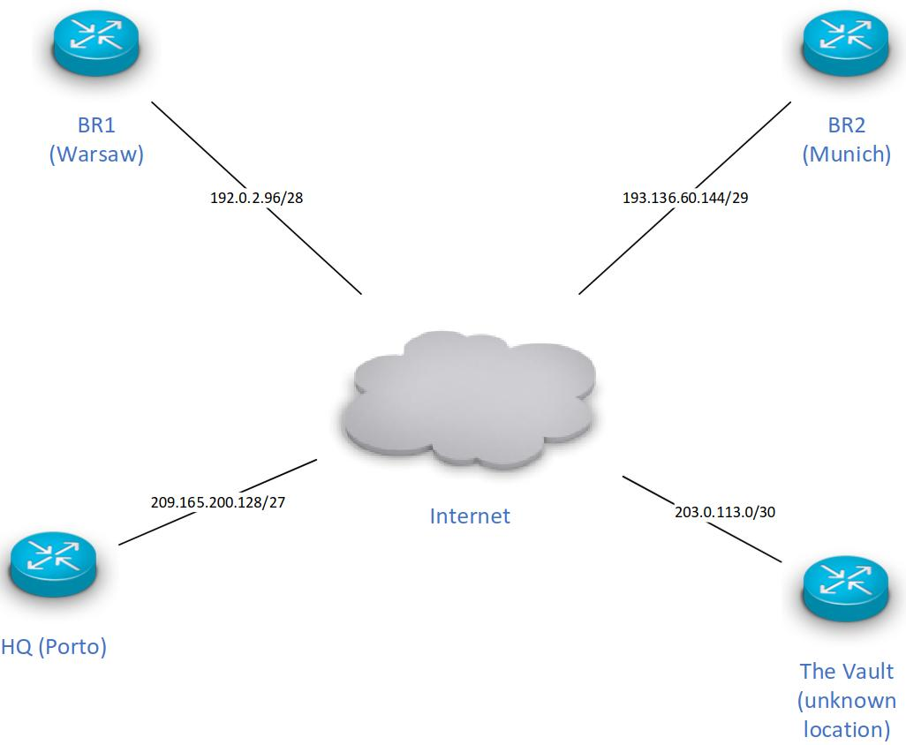
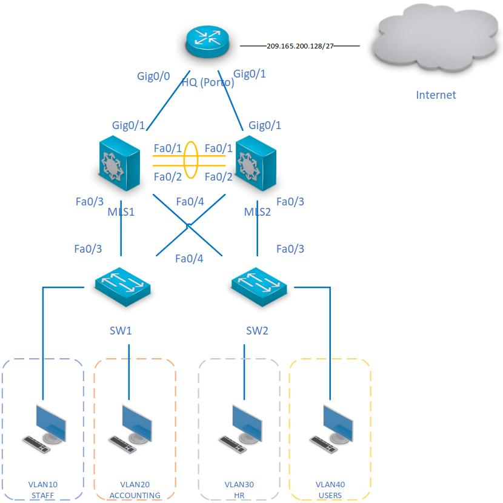
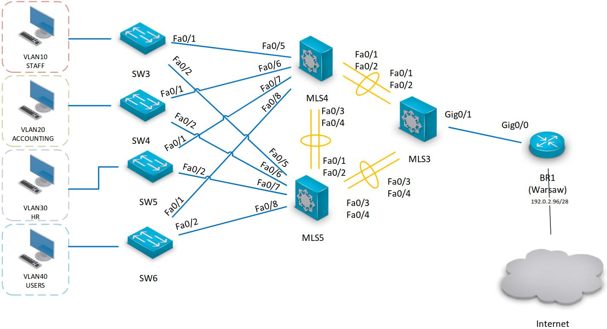
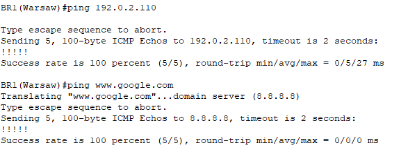
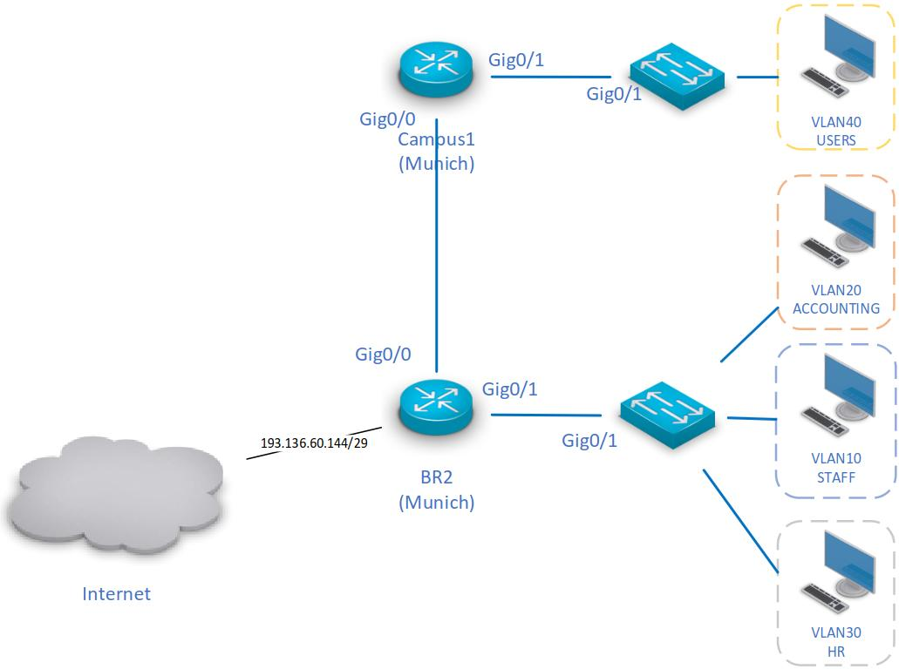
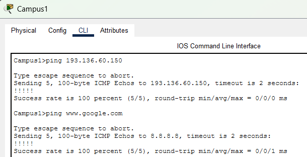
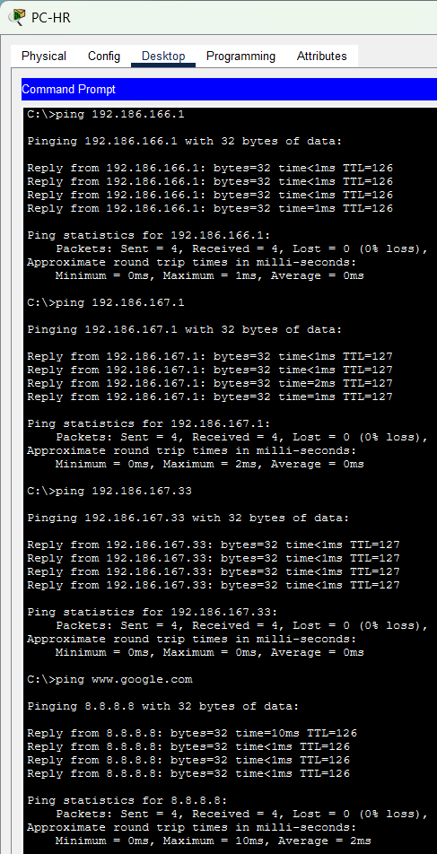
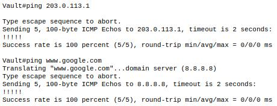

# Sprint 1

## M1B - Team 3

| Name                     | Student Number | Role / Site Responsibility |
| ------------------------ | -------------- | -------------------------- |
|                          |                | *Oporto (HQ)*            |
| *João Fernandes*      | *1211681*    | *Warsaw (BR1)*           |
| *Michał Binek*        | *1260224*    | *Munich (BR2)*           |
| *Francisco Magalhães* | *1170589*    | *The Vault*              |

## General Configuration

- All unused switch ports are assigned to VLAN 99 and administratively shutdown;

---

## 1. Oporto (HQ)

### <u></u> 10.42.56.0/22

### 1.1 Network Addressing Table

| Network              | Hosts req. | CIDR | Mask            | Network Address | Broadcast Address | First Host   | Last Host    |
| -------------------- | ---------- | ---- | --------------- | --------------- | ----------------- | ------------ | ------------ |
| VLAN40 – USERS      | 500        | /23  | 255.255.254.0   | 10.42.56.0      | 10.42.57.255      | 10.42.56.1   | 10.42.57.254 |
| VLAN20 – ACCOUNTING | 200        | /24  | 255.255.255.0   | 10.42.58.0      | 10.42.58.255      | 10.42.58.1   | 10.42.58.254 |
| VLAN30 – HR         | 100        | /25  | 255.255.255.128 | 10.42.59.0      | 10.42.59.127      | 10.42.59.1   | 10.42.59.126 |
| VLAN10 – STAFF      | 50         | /26  | 255.255.255.192 | 10.42.59.128    | 10.42.59.191      | 10.42.59.129 | 10.42.59.190 |
| HQ ↔ MLS1           | 2          | /30  | 255.255.255.252 | 10.42.59.192    | 10.42.59.195      | 10.42.59.193 | 10.42.59.194 |
| HQ ↔ MLS2           | 2          | /30  | 255.255.255.252 | 10.42.59.196    | 10.42.59.199      | 10.42.59.197 | 10.42.59.198 |

### 1.2 Interface Addressing Table

#### 1.2.1 HQ (Oporto)

| Interface | Assigned IP   | Subnet Mask | Purpose                  |
| --------- | ------------- | ----------- | ------------------------ |
| Gig0/0    | 10.42.59.193  | /30         | Link to MLS1             |
| Gig0/1    | 10.42.59.197  | /30         | Link to MLS2             |
| Gig0/0/0  | DHCP-assigned | /27         | Internet (SP) connection |

#### 1.2.2 MLS1

| Interface | Assigned IP  | Subnet Mask | Purpose              |
| --------- | ------------ | ----------- | -------------------- |
| Gig0/1    | 10.42.59.194 | /30         | Link to HQ (Oporto) |
| Fa0/1     | —           | —          |                      |
| Fa0/2     | —           | —          |                      |
| Fa0/3     | —           | —          |                      |
| Fa0/4     | —           | —          |                      |

#### 1.2.3 MLS2

| Interface | Assigned IP  | Subnet Mask | Purpose              |
| --------- | ------------ | ----------- | -------------------- |
| Gig0/1    | 10.42.59.198 | /30         | Link to HQ (Oporto) |
| Fa0/1     | —           | —          |                      |
| Fa0/2     | —           | —          |                      |
| Fa0/3     | —           | —          |                      |
| Fa0/4     | —           | —          |                      |

#### 1.2.4 SW1

| Interface | Purpose |
| --------- | ------- |
|           |         |
|           |         |
| Fa0/3     |         |
| Fa0/4     |         |

#### 1.2.5 SW2

| Interface | Purpose |
| --------- | ------- |
|           |         |
|           |         |
| Fa0/3     |         |
| Fa0/4     |         |

#### 1.2.6 Oporto-STAFF

| Interface | Assigned IP   | Subnet Mask | Purpose     |
| --------- | ------------- | ----------- | ----------- |
| Fa0       | DHCP-assigned | /26         | VLAN10 host |

#### 1.2.7 Oporto-ACCOUNTING

| Interface | Assigned IP   | Subnet Mask | Purpose     |
| --------- | ------------- | ----------- | ----------- |
| Fa0       | DHCP-assigned | /24         | VLAN20 host |

#### 1.2.8 Oporto-HR

| Interface | Assigned IP   | Subnet Mask | Purpose     |
| --------- | ------------- | ----------- | ----------- |
| Fa0       | DHCP-assigned | /25         | VLAN30 host |

#### 1.2.9 Oporto-USERS

| Interface | Assigned IP   | Subnet Mask | Purpose     |
| --------- | ------------- | ----------- | ----------- |
| Fa0       | DHCP-assigned | /23         | VLAN40 host |

### 1.3 Connectivity Tests

| Source        | Destination        | Test Type | Result  |
| ------------- | ------------------ | --------- | ------- |
| HQ Router     | SP gateway         | `ping`  | Success |
| HQ Router     | www.google.com     | `ping`  | Success |
| HQ PC (STAFF) | HQ PC (ACCOUNTING) | `ping`  | Success |
| HQ PC (STAFF) | HQ PC (HR)         | `ping`  | Success |
| HQ PC (STAFF) | HQ PC (USERS)      | `ping`  | Success |

---

## 2. Warsaw (BR1)

### <u></u> 172.23.68.0/23

### 2.1 Network Addressing Table

| Network              | Hosts req. | CIDR | Mask            | Network Address | Broadcast Address | First Host   | Last Host     |
| -------------------- | ---------- | ---- | --------------- | --------------- | ----------------- | ------------ | ------------- |
| VLAN40 – USERS      | 200        | /24  | 255.255.255.0   | 172.23.68.0     | 172.23.68.255     | 172.23.68.1  | 172.23.68.254 |
| VLAN10 – STAFF      | 30         | /27  | 255.255.255.224 | 172.23.69.0     | 172.23.69.31      | 172.23.69.1  | 172.23.69.30  |
| VLAN20 – ACCOUNTING | 20         | /27  | 255.255.255.224 | 172.23.69.32    | 172.23.69.63      | 172.23.69.33 | 172.23.69.62  |
| VLAN30 – HR         | 10         | /28  | 255.255.255.240 | 172.23.69.64    | 172.23.69.79      | 172.23.69.65 | 172.23.69.78  |
| MLS3 ↔ BR1          | 2          | /30  | 255.255.255.252 | 172.23.69.80    | 172.23.69.83      | 172.23.69.81 | 172.23.69.82  |
| MLS3 ↔ MLS4         | 2          | /30  | 255.255.255.252 | 172.23.69.84    | 172.23.69.87      | 172.23.69.85 | 172.23.69.86  |
| MLS3 ↔ MLS5         | 2          | /30  | 255.255.255.252 | 172.23.69.88    | 172.23.69.91      | 172.23.69.89 | 172.23.69.90  |

### 2.2 Interface Addressing Table

#### 2.2.1 BR1 (Warsaw)

| Interface | Assigned IP                | Subnet Mask | Purpose                                         |
| --------- | -------------------------- | ----------- | ----------------------------------------------- |
| Gig0/0    | 172.23.69.82               | /30         | Link to MLS3 (Gig0/1)                           |
| Gig0/1    | —                         | —          | Unused (administratively shut down)             |
| Gig0/0/0  | DHCP-assigned (192.0.2.97) | /28         | Internet (SP) connection — gateway 192.0.2.110 |

#### 2.2.2 MLS3

| Interface             | Assigned IP  | Subnet Mask | Purpose                                                                        |
| --------------------- | ------------ | ----------- | ------------------------------------------------------------------------------ |
| Gig0/1                | 172.23.69.81 | /30         | Routed port — link to BR1 (Warsaw) Gig0/0                                     |
| VLAN100               | 172.23.69.85 | /30         | Transit SVI — Layer 3 link to MLS4                                            |
| VLAN101               | 172.23.69.89 | /30         | Transit SVI — Layer 3 link to MLS5                                            |
| Po1                   | —           | —          | LACP EtherChannel to MLS4 — 802.1Q trunk, native VLAN 50, all VLANs except 99 |
| Fa0/1                 | —           | —          | Po1 member — to MLS4 Fa0/1                                                    |
| Fa0/2                 | —           | —          | Po1 member — to MLS4 Fa0/2                                                    |
| Po2                   | —           | —          | LACP EtherChannel to MLS5 — 802.1Q trunk, native VLAN 50, all VLANs except 99 |
| Fa0/3                 | —           | —          | Po2 member — to MLS5 Fa0/3                                                    |
| Fa0/4                 | —           | —          | Po2 member — to MLS5 Fa0/4                                                    |
| Fa0/5–Fa0/24, Gig0/2 | —           | —          | Unused — VLAN 99, administratively shut down                                  |

#### 2.2.3 MLS4

| Interface                     | Assigned IP  | Subnet Mask | Purpose                                                                        |
| ----------------------------- | ------------ | ----------- | ------------------------------------------------------------------------------ |
| VLAN10                        | 172.23.69.2  | /27         | STAFF SVI — HSRP group 10, **active** (virtual IP 172.23.69.1)          |
| VLAN20                        | 172.23.69.34 | /27         | ACCOUNTING SVI — HSRP group 20, **active** (virtual IP 172.23.69.33)    |
| VLAN30                        | 172.23.69.66 | /28         | HR SVI — HSRP group 30, standby (virtual IP 172.23.69.65)                     |
| VLAN40                        | 172.23.68.2  | /24         | USERS SVI — HSRP group 40, standby (virtual IP 172.23.68.1)                   |
| VLAN100                       | 172.23.69.86 | /30         | Transit SVI — Layer 3 link to MLS3                                            |
| Po1                           | —           | —          | LACP EtherChannel to MLS3 — 802.1Q trunk, native VLAN 50, all VLANs except 99 |
| Fa0/1                         | —           | —          | Po1 member — to MLS3 Fa0/1                                                    |
| Fa0/2                         | —           | —          | Po1 member — to MLS3 Fa0/2                                                    |
| Po3                           | —           | —          | LACP EtherChannel to MLS5 — 802.1Q trunk, native VLAN 50, all VLANs except 99 |
| Fa0/3                         | —           | —          | Po3 member — to MLS5 Fa0/1                                                    |
| Fa0/4                         | —           | —          | Po3 member — to MLS5 Fa0/2                                                    |
| Fa0/5                         | —           | —          | Trunk to SW3 Fa0/1                                                             |
| Fa0/6                         | —           | —          | Trunk to SW4 Fa0/1                                                             |
| Fa0/7                         | —           | —          | Trunk to SW5 Fa0/1                                                             |
| Fa0/8                         | —           | —          | Trunk to SW6 Fa0/1                                                             |
| Fa0/9–Fa0/24, Gig0/1–Gig0/2 | —           | —          | Unused — VLAN 99, administratively shut down                                  |

#### 2.2.4 MLS5

| Interface                     | Assigned IP  | Subnet Mask | Purpose                                                                        |
| ----------------------------- | ------------ | ----------- | ------------------------------------------------------------------------------ |
| VLAN10                        | 172.23.69.3  | /27         | STAFF SVI — HSRP group 10, standby (virtual IP 172.23.69.1)                   |
| VLAN20                        | 172.23.69.35 | /27         | ACCOUNTING SVI — HSRP group 20, standby (virtual IP 172.23.69.33)             |
| VLAN30                        | 172.23.69.67 | /28         | HR SVI — HSRP group 30, **active** (virtual IP 172.23.69.65)            |
| VLAN40                        | 172.23.68.3  | /24         | USERS SVI — HSRP group 40, **active** (virtual IP 172.23.68.1)          |
| VLAN101                       | 172.23.69.90 | /30         | Transit SVI — Layer 3 link to MLS3                                            |
| Po3                           | —           | —          | LACP EtherChannel to MLS4 — 802.1Q trunk, native VLAN 50, all VLANs except 99 |
| Fa0/1                         | —           | —          | Po3 member — to MLS4 Fa0/3                                                    |
| Fa0/2                         | —           | —          | Po3 member — to MLS4 Fa0/4                                                    |
| Po2                           | —           | —          | LACP EtherChannel to MLS3 — 802.1Q trunk, native VLAN 50, all VLANs except 99 |
| Fa0/3                         | —           | —          | Po2 member — to MLS3 Fa0/3                                                    |
| Fa0/4                         | —           | —          | Po2 member — to MLS3 Fa0/4                                                    |
| Fa0/5                         | —           | —          | Trunk to SW3 Fa0/2                                                             |
| Fa0/6                         | —           | —          | Trunk to SW4 Fa0/2                                                             |
| Fa0/7                         | —           | —          | Trunk to SW5 Fa0/2                                                             |
| Fa0/8                         | —           | —          | Trunk to SW6 Fa0/2                                                             |
| Fa0/9–Fa0/24, Gig0/1–Gig0/2 | —           | —          | Unused — VLAN 99, administratively shut down                                  |

#### 2.2.5 SW3

| Interface                      | Purpose                                                       |
| ------------------------------ | ------------------------------------------------------------- |
| Fa0/1                          | Trunk to MLS4 Fa0/5 — native VLAN 50, all VLANs except 99    |
| Fa0/2                          | Trunk to MLS5 Fa0/5 — native VLAN 50, all VLANs except 99    |
| Fa0/3–Fa0/5                   | Access — VLAN 10 (STAFF), PortFast; Warsaw-STAFF PC on Fa0/3 |
| Fa0/6–Fa0/10                  | Access — VLAN 20 (ACCOUNTING), PortFast                      |
| Fa0/11–Fa0/15                 | Access — VLAN 30 (HR), PortFast                              |
| Fa0/16–Fa0/20                 | Access — VLAN 40 (USERS), PortFast                           |
| Fa0/21–Fa0/24, Gig0/1–Gig0/2 | Unused — VLAN 99, administratively shut down                 |

#### 2.2.6 SW4

| Interface                      | Purpose                                                                 |
| ------------------------------ | ----------------------------------------------------------------------- |
| Fa0/1                          | Trunk to MLS4 Fa0/6 — native VLAN 50, all VLANs except 99              |
| Fa0/2                          | Trunk to MLS5 Fa0/6 — native VLAN 50, all VLANs except 99              |
| Fa0/3–Fa0/5                   | Access — VLAN 10 (STAFF), PortFast                                     |
| Fa0/6–Fa0/10                  | Access — VLAN 20 (ACCOUNTING), PortFast; Warsaw-ACCOUNTING PC on Fa0/6 |
| Fa0/11–Fa0/15                 | Access — VLAN 30 (HR), PortFast                                        |
| Fa0/16–Fa0/20                 | Access — VLAN 40 (USERS), PortFast                                     |
| Fa0/21–Fa0/24, Gig0/1–Gig0/2 | Unused — VLAN 99, administratively shut down                           |

#### 2.2.7 SW5

| Interface                      | Purpose                                                    |
| ------------------------------ | ---------------------------------------------------------- |
| Fa0/1                          | Trunk to MLS4 Fa0/7 — native VLAN 50, all VLANs except 99 |
| Fa0/2                          | Trunk to MLS5 Fa0/7 — native VLAN 50, all VLANs except 99 |
| Fa0/3–Fa0/5                   | Access — VLAN 10 (STAFF), PortFast                        |
| Fa0/6–Fa0/10                  | Access — VLAN 20 (ACCOUNTING), PortFast                   |
| Fa0/11–Fa0/15                 | Access — VLAN 30 (HR), PortFast; Warsaw-HR PC on Fa0/11   |
| Fa0/16–Fa0/20                 | Access — VLAN 40 (USERS), PortFast                        |
| Fa0/21–Fa0/24, Gig0/1–Gig0/2 | Unused — VLAN 99, administratively shut down              |

#### 2.2.8 SW6

| Interface                      | Purpose                                                        |
| ------------------------------ | -------------------------------------------------------------- |
| Fa0/1                          | Trunk to MLS4 Fa0/8 — native VLAN 50, all VLANs except 99     |
| Fa0/2                          | Trunk to MLS5 Fa0/8 — native VLAN 50, all VLANs except 99     |
| Fa0/3–Fa0/5                   | Access — VLAN 10 (STAFF), PortFast                            |
| Fa0/6–Fa0/10                  | Access — VLAN 20 (ACCOUNTING), PortFast                       |
| Fa0/11–Fa0/15                 | Access — VLAN 30 (HR), PortFast                               |
| Fa0/16–Fa0/20                 | Access — VLAN 40 (USERS), PortFast; Warsaw-USERS PC on Fa0/16 |
| Fa0/21–Fa0/24, Gig0/1–Gig0/2 | Unused — VLAN 99, administratively shut down                  |

#### 2.2.9 Warsaw-STAFF

| Interface | Assigned IP   | Subnet Mask | Purpose                                   |
| --------- | ------------- | ----------- | ----------------------------------------- |
| Fa0       | DHCP-assigned | /27         | VLAN10 host — gateway 172.23.69.1 (HSRP) |

#### 2.2.10 Warsaw-ACCOUNTING

| Interface | Assigned IP   | Subnet Mask | Purpose                                    |
| --------- | ------------- | ----------- | ------------------------------------------ |
| Fa0       | DHCP-assigned | /27         | VLAN20 host — gateway 172.23.69.33 (HSRP) |

#### 2.2.11 Warsaw-HR

| Interface | Assigned IP   | Subnet Mask | Purpose                                    |
| --------- | ------------- | ----------- | ------------------------------------------ |
| Fa0       | DHCP-assigned | /28         | VLAN30 host — gateway 172.23.69.65 (HSRP) |

#### 2.2.12 Warsaw-USERS

| Interface | Assigned IP   | Subnet Mask | Purpose                                   |
| --------- | ------------- | ----------- | ----------------------------------------- |
| Fa0       | DHCP-assigned | /24         | VLAN40 host — gateway 172.23.68.1 (HSRP) |

### 2.3 Configuration Decisions

#### 2.3.1 Addressing

- **VLSM, largest network first:** All Warsaw networks fit inside `172.23.68.0/23`. The range `172.23.69.92–172.23.69.255` is left free for later sprints.
- **STAFF as /27:** The brief lists "STAFF (30)" without the word "users", unlike the other networks. I read it as 30 hosts in total. A /27 gives 30 usable addresses; 3 go to HSRP (virtual IP and the two SVIs), which leaves 27 for DHCP clients.
- **Fixed pattern in every user VLAN:** first usable address = HSRP virtual IP (default gateway), second = MLS4, third = MLS5. These three addresses are excluded from DHCP.

#### 2.3.2 VLANs and VTP

- **VTP domain** `RECOMP2627M1B03`, password `7262pmocer`. MLS3, MLS4 and MLS5 are VTP servers; SW3–SW6 are VTP clients.
- **VLANs are created only on MLS4** and reach the other switches through VTP.

| VLAN | Name              | Use                                    |
| ---- | ----------------- | -------------------------------------- |
| 10   | STAFF             | User network                           |
| 20   | ACCOUNTING        | User network                           |
| 30   | HR                | User network                           |
| 40   | USERS             | User network                           |
| 50   | NATIVE            | Native VLAN on every trunk             |
| 99   | BLACKHOLE         | Unused ports; not allowed on any trunk |
| 100  | TRANSIT-MLS3-MLS4 | Layer 3 transit between MLS3 and MLS4  |
| 101  | TRANSIT-MLS3-MLS5 | Layer 3 transit between MLS3 and MLS5  |

#### 2.3.3 Interconnection between MLS3, MLS4 and MLS5

- **The brief is contradictory here.** Section 4.2 asks for Layer 2 802.1Q trunks aggregated with LACP; section 4.3 says the MLS3–MLS4 and MLS3–MLS5 connections operate in Layer 3 with IP addresses.
- **Both requirements are met:** the physical links are LACP EtherChannels configured as 802.1Q trunks (native VLAN 50, all VLANs except 99). The Layer 3 part runs over **transit VLANs 100 and 101**, with SVIs addressed from the two /30 networks in the addressing table.
- VLANs 100 and 101 are not in the brief; they were added only for this purpose.

| Port-channel | Between      | Ports                          | Protocol |
| ------------ | ------------ | ------------------------------ | -------- |
| Po1          | MLS3 ↔ MLS4 | MLS3 Fa0/1–2 ↔ MLS4 Fa0/1–2 | LACP     |
| Po2          | MLS3 ↔ MLS5 | MLS3 Fa0/3–4 ↔ MLS5 Fa0/3–4 | LACP     |
| Po3          | MLS4 ↔ MLS5 | MLS4 Fa0/3–4 ↔ MLS5 Fa0/1–2 | LACP     |

#### 2.3.4 Rapid-PVST+ and HSRP

- **Rapid-PVST+** runs on every switch. The HSRP active switch of each VLAN is the STP root of that VLAN, as required.
- **HSRP:** group number = VLAN ID; the active switch has priority 110 and both switches use `preempt`, so the active role returns after a failure.
- **MLS3 keeps the default STP priority** and is never root.
- **Access ports use PortFast**, so hosts get their DHCP lease without waiting for STP.

| VLAN | STP root (primary) | STP secondary root | HSRP active | Virtual IP   |
| ---- | ------------------ | ------------------ | ----------- | ------------ |
| 10   | MLS4               | MLS5               | MLS4        | 172.23.69.1  |
| 20   | MLS4               | MLS5               | MLS4        | 172.23.69.33 |
| 30   | MLS5               | MLS4               | MLS5        | 172.23.69.65 |
| 40   | MLS5               | MLS4               | MLS5        | 172.23.68.1  |
| 100  | MLS4               | —                 | —          | —           |
| 101  | MLS5               | —                 | —          | —           |

#### 2.3.5 Routing

`ip routing` is enabled on MLS3, MLS4 and MLS5. All routes are static.

| Device | Destination    | Next hop                      | Notes                               |
| ------ | -------------- | ----------------------------- | ----------------------------------- |
| MLS4   | 0.0.0.0/0      | 172.23.69.85 (MLS3)           | Default route                       |
| MLS5   | 0.0.0.0/0      | 172.23.69.89 (MLS3)           | Default route                       |
| MLS3   | 172.23.68.0/23 | 172.23.69.86 and 172.23.69.90 | Equal-cost routes via MLS4 and MLS5 |
| MLS3   | 0.0.0.0/0      | 172.23.69.82 (BR1)            | Default route                       |
| BR1    | 172.23.68.0/23 | 172.23.69.81 (MLS3)           | Return route to the Warsaw networks |
| BR1    | 0.0.0.0/0      | 192.0.2.110 (SP)              | Learned from the SP through DHCP    |

#### 2.3.6 DHCP

Identical (duplicated) pools on MLS4 and MLS5. Every pool uses DNS server `8.8.8.8` and domain `RECOMP2627M1B03.recomp.com`.

| Pool       | Network         | Default gateway (HSRP) | Excluded                   |
| ---------- | --------------- | ---------------------- | -------------------------- |
| STAFF      | 172.23.69.0/27  | 172.23.69.1            | 172.23.69.1–172.23.69.3   |
| ACCOUNTING | 172.23.69.32/27 | 172.23.69.33           | 172.23.69.33–172.23.69.35 |
| HR         | 172.23.69.64/28 | 172.23.69.65           | 172.23.69.65–172.23.69.67 |
| USERS      | 172.23.68.0/24  | 172.23.68.1            | 172.23.68.1–172.23.68.3   |

#### 2.3.7 Known limitations

- **No Internet access from hosts:** Warsaw uses private addresses and BR1 has no NAT yet. This is not required in Sprint 1.
- **Static routes do not detect failures:** if MLS4 or MLS5 goes down, MLS3 keeps sending part of the traffic coming from BR1 to it. A dynamic routing protocol would solve this.
- **Duplicated DHCP pools:** in a real network both servers could lease the same address to different clients. Splitting each range between the two servers would avoid it.

### 2.4 Connectivity Tests

| Source                        | Destination                         | Test Type                           | Result                                               |
| ----------------------------- | ----------------------------------- | ----------------------------------- | ---------------------------------------------------- |
| BR1 Router                    | SP gateway (192.0.2.110)            | `ping`                            | Success                                              |
| BR1 Router                    | www.google.com                      | `ping`                            | Success                                              |
| Warsaw PC (STAFF)             | Warsaw PC (ACCOUNTING)              | `ping`                            | Success                                              |
| Warsaw PC (STAFF)             | Warsaw PC (HR)                      | `ping`                            | Success                                              |
| Warsaw PC (STAFF)             | Warsaw PC (USERS)                   | `ping`                            | Success                                              |
| Warsaw PC (STAFF)             | BR1 Gig0/0 (172.23.69.82)           | `ping`                            | Success                                              |
| Warsaw PC (STAFF)             | Warsaw PC (HR)                      | `tracert`                         | Success — first hop 172.23.69.2 (MLS4, HSRP active) |
| HSRP failover (MLS4 isolated) | Warsaw PC (STAFF) → Warsaw PC (HR) | `ping -t`, `show standby brief` | MLS5 became active for VLANs 10 and 20               |

**BR1 → SP gateway and www.google.com**

**Warsaw PC (STAFF): DHCP-assigned address and ping to ACCOUNTING**

**Warsaw PC (STAFF): ping to HR and USERS**

**Warsaw PC (STAFF): ping to BR1 and traceroute to HR (first hop MLS4)**

**HSRP failover: MLS4 isolated, MLS5 takes over VLANs 10 and 20**

### 2.5 Configuration Verification

| Command                       | Device(s)        | Confirms                                                       |
| ----------------------------- | ---------------- | -------------------------------------------------------------- |
| `show vtp status`           | MLS4, SW3        | VTP domain, server/client mode, synchronized revision          |
| `show vlan brief`           | MLS4, SW3        | VLAN names and access-port membership; unused ports in VLAN 99 |
| `show etherchannel summary` | MLS3, MLS4, MLS5 | Po1, Po2, Po3 in use (SU), LACP, all members bundled (P)       |
| `show interfaces trunk`     | MLS4, SW3        | 802.1Q, native VLAN 50, VLAN 99 not allowed                    |
| `show spanning-tree vlan X` | MLS4, MLS5       | Root bridges per VLAN as in 2.3.4                              |
| `show standby brief`        | MLS4, MLS5       | HSRP active/standby roles as in 2.3.4                          |
| `show ip route`             | MLS3, BR1        | Static and default routes as in 2.3.5                          |
| `show ip dhcp binding`      | MLS4, MLS5       | Leases handed to the Warsaw PCs                                |

<!--  -->

---

## 3. Munich (BR2)

### <u></u> 192.186.166.0/23

### 3.1 Network Addressing Table

| Network              | Hosts req. | CIDR | Mask            | Network Address | Broadcast Address | First Host     | Last Host       |
| -------------------- | ---------- | ---- | --------------- | --------------- | ----------------- | -------------- | --------------- |
| VLAN40 – USERS      | 200        | /24  | 255.255.255.0   | 192.186.166.0   | 192.186.166.255   | 192.186.166.1  | 192.186.166.254 |
| VLAN20 – ACCOUNTING | 20         | /27  | 255.255.255.224 | 192.186.167.0   | 192.186.167.31    | 192.186.167.1  | 192.186.167.30  |
| VLAN10 – STAFF      | 10         | /28  | 255.255.255.240 | 192.186.167.32  | 192.186.167.47    | 192.186.167.33 | 192.186.167.46  |
| VLAN30 – HR         | 10         | /28  | 255.255.255.240 | 192.186.167.48  | 192.186.167.63    | 192.186.167.49 | 192.186.167.62  |
| BR2 ↔ Campus1       | 2          | /30  | 255.255.255.252 | 192.186.167.64  | 192.186.167.67    | 192.186.167.65 | 192.186.167.66  |

##### 3.2 Configuration Decisions

###### 3.2.1 BR2 router: Internet (SP) connection (Gig0/0/0)

* **Static addressing:**  The Munich edge router BR2 connects to the Service Provider via interface Gig0/0/0 using static IP address 193.136.60.147/29 with gateway 193.136.60.150.
* **Default route:**  Configured static default route `ip route 0.0.0.0 0.0.0.0 193.136.60.150` pointing to the SP gateway.

###### 3.2.2 BR2 and Campus1 routers: internal interfaces and routing

* **Point-to-point link:**  Configured a /30 subnet (192.186.167.64/30) on the link between BR2 (Gig0/0: 192.186.167.65) and Campus1 (Gig0/0: 192.186.167.66).
* **Campus1 default route:**  Configured `ip route 0.0.0.0 0.0.0.0 192.186.167.65` on Campus1 so all outbound traffic is forwarded to BR2.
* **BR2 return route:**  Configured static route `ip route 192.186.166.0 255.255.255.0 192.186.167.66` on BR2 to reach the USERS subnet behind Campus1.
* **Router-on-a-Stick (BR2):**  Configured dot1Q subinterfaces Gig0/1.10, Gig0/1.20, and Gig0/1.30 on BR2 to serve as default gateways for STAFF, ACCOUNTING, and HR using the last available host address in each subnet.
* **Campus1 LAN interface:**  Configured Gig0/1 on Campus1 with IP 192.186.166.254/24 (last available host address) as the default gateway for USERS (VLAN 40).
* **DHCP Pools:**  Configured DHCP pools on BR2 for STAFF, ACCOUNTING, and HR, and on Campus1 for USERS. Excluded gateway IPs and configured DNS server 8.8.8.8 and domain name RECOMP2627M1B03.recomp.com across all pools.

###### 3.2.3 Switches SW7 and SW8: VLANs and ports

* **SW7 (Trunk Switch):**  Configured Gig0/1 as an 802.1Q trunk to BR2 with Native VLAN 50 and allowed VLANs 10, 20, 30, and 50. Configured Fa0/1-Fa0/5 for VLAN 10 (STAFF), Fa0/6-Fa0/10 for VLAN 20 (ACCOUNTING), and Fa0/11-Fa0/15 for VLAN 30 (HR).
* **SW8 (Access Switch):**  Configured Gig0/1 as an access port in VLAN 40 (USERS) connected to Campus1 Gig0/1. Configured Fa0/1-Fa0/24 as access ports for VLAN 40.
* **VLAN 99 (BLACKHOLE) created locally:**  Created VLAN 99 on both switches for port security. All unused ports (Fa0/16–Fa0/24 & Gig0/2 on SW7, Gig0/2 on SW8) are assigned to VLAN 99 and administratively shut down. No trunk allows VLAN 99.

### 3.3 Interface Addressing Table

#### 3.3.1 BR2 (Munich)

| Interface | Assigned IP    | Subnet Mask | Purpose                                     |
| --------- | -------------- | ----------- | ------------------------------------------- |
| Gig0/0    | 192.186.167.65 | /30         | Link to Campus1 (Munich)                   |
| Gig0/1.10 | 192.186.167.46 | /28         | STAFF gateway (last available address)      |
| Gig0/1.20 | 192.186.167.30 | /27         | ACCOUNTING gateway (last available address) |
| Gig0/1.30 | 192.186.167.62 | /28         | HR gateway (last available address)         |
| Gig0/0/0  | 193.136.60.147 | /29         | Internet (SP) connection - static           |

#### 3.2.2 Campus1 (Munich)

| Interface | Assigned IP    | Subnet Mask | Purpose                                |
| --------- | -------------- | ----------- | -------------------------------------- |
| Gig0/0    | 192.186.167.66 | /30         | Link to BR2 (Munich)                  |
| Gig0/1    | 192.186.166.1  | /24         | USERS gateway (last available address) |

#### 3.3.3 SW7

| Interface              | Purpose                                                             |
| ---------------------- | ------------------------------------------------------------------- |
| Gig0/1                 | Trunk to BR2 Gig0/1 - native VLAN 50, allowed VLANs 10, 20, 30, 50 |
| Fa0/1–Fa0/5           | Access - VLAN 10 (STAFF)                                            |
| Fa0/6–Fa0/10          | Access - VLAN 20 (ACCOUNTING)                                       |
| Fa0/11–Fa0/15         | Access - VLAN 30 (HR)                                               |
| Fa0/16–Fa0/24, Gig0/2 | Unused - VLAN 99, administratively shut down                        |

#### 3.3.4 SW8

| Interface     | Purpose                                          |
| ------------- | ------------------------------------------------ |
| Gig0/1        | Access link to Campus1 Gig0/1 - VLAN 40 (USERS) |
| Fa0/1–Fa0/24 | Access - VLAN 40 (USERS)                         |
| Gig0/2        | Unused - VLAN 99, administratively shut down     |

#### 3.3.5 Munich-USERS

| Interface | Assigned IP   | Subnet Mask | Purpose     |
| --------- | ------------- | ----------- | ----------- |
| Fa0       | DHCP-assigned | /24         | VLAN40 host |

#### 3.3.6 Munich-ACCOUNTING

| Interface | Assigned IP   | Subnet Mask | Purpose     |
| --------- | ------------- | ----------- | ----------- |
| Fa0       | DHCP-assigned | /27         | VLAN20 host |

#### 3.3.7 Munich-STAFF

| Interface | Assigned IP   | Subnet Mask | Purpose     |
| --------- | ------------- | ----------- | ----------- |
| Fa0       | DHCP-assigned | /28         | VLAN10 host |

#### 3.3.8 Munich-HR

| Interface | Assigned IP   | Subnet Mask | Purpose     |
| --------- | ------------- | ----------- | ----------- |
| Fa0       | DHCP-assigned | /28         | VLAN30 host |

### 3.3 Connectivity Tests

---

## 4. The Vault

### <u></u> 10.31.111.0/24

### 4.1 Configuration Decisions

#### 4.1.1 Vault router: Internet (SP) connection (Gig0/0/0)

- **Static addressing:** The Vault is the one site whose SP link is configured manually, not by DHCP. I used the values given in the problem statement: `203.0.113.2/30`, with `203.0.113.1` as the gateway.
- **Default route:** I configured `ip route 0.0.0.0 0.0.0.0 203.0.113.1`. The Vault has a single exit toward the Internet, so one default route is enough and no routing protocol is needed.

#### 4.1.2 Vault router: internal interface (Gig0/1)

- I left Gig0/1 **unaddressed and administratively shut down**. The brief says the Vault’s internal details “will be disclosed as required during the project,” so there is no network to serve yet.
- I did **not** assign any address from `10.31.111.0/24`. The block is reserved for later sprints.
- Keeping an unneeded interface shut down also stops it from being used as an unintended entry point.

#### 4.1.3 Vault switch: VLANs and ports

- **VLAN 99 (BLACKHOLE) created locally:** The Vault is a separate site and does not share a VTP domain with HQ, Warsaw or Munich, so VLAN 99 is not inherited and had to be created on this switch.
- **All unused ports are assigned to VLAN 99 and shut down:** This covers `Fa0/1–Fa0/24`, `Gig0/1` and `Gig0/2`. Since the Vault has no internal hosts yet, every port, including the router uplink, counts as unused.
- **VLAN 1 not used:** No port is left in the default VLAN 1, as instructed. `show vlan brief` shows no interfaces in VLAN 1.
- **No trunks configured:** The only link, Router Gig0/1 ↔ Switch Gig0/1, carries no tagged traffic, so no trunk exists.

### 4.2 Interface Addressing Table

#### 4.2.1 Vault (unknown location)

| Interface | Assigned IP      | Subnet Mask | Purpose                                           |
| --------- | ---------------- | ----------- | ------------------------------------------------- |
| Gig0/0/0  | 203.0.113.2      | /30         | Internet (SP) connection — static                |
| Gig0/1    | *(unassigned)* | —          | Link to Vault Switch (administratively shut down) |

#### 4.2.2 Vault Switch

| Interface | Purpose                                                                         |
| --------- | ------------------------------------------------------------------------------- |
| Gig0/1    | Link to Vault Router (unused - assigned to VLAN 99, administratively shut down) |

### 4.3 Connectivity Tests

| Source       | Destination              | Test Type | Result  |
| ------------ | ------------------------ | --------- | ------- |
| Vault Router | SP gateway (203.0.113.1) | `ping`  | Success |
| Vault Router | www.google.com           | `ping`  | Success |

