## 1. Routing Configuration Between Branches

### 1.1 Edge routers (Oporto and Warsaw)

In Sprint 1, the Oporto and Warsaw routers received their Internet address and gateway through DHCP. The DHCP client installs a default route with administrative distance 254, shown as `S* 0.0.0.0/0 [254/0]`. 

The task asks for a manually configured static default route using the same gateway, which has the default administrative distance 1 (the DHCP-installed one has 254). The static route is present in the running configuration of both routers; `show ip route` in Packet Tracer still lists the DHCP entry (`[254/0]`) for the same gateway. 

When the static route is entered manually the entry is shown as `[1/0]`, but after Packet Tracer is restarted the table goes back to `[254/0]` on both routers, which is what Figures 3 and 9 show.

In both cases the next hop is the gateway received from DHCP (209.165.200.158 on Oporto, 192.0.2.110 on BR1), so the forwarding and the tests in section 1.3 are the same.

The gateways were taken from `show ip route` and `show dhcp lease`:

| Router       | Internet interface | DHCP address       | Gateway (SP)    |
| ------------ | ------------------ | ------------------ | --------------- |
| Oporto (HQ)  | Gig0/0/0           | 209.165.200.129/27 | 209.165.200.158 |
| BR1 (Warsaw) | Gig0/0/0           | 192.0.2.97/28      | 192.0.2.110     |

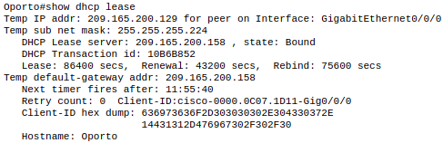

*Figure 1: `show dhcp lease` on Oporto. Address 209.165.200.129, default gateway 209.165.200.158.*

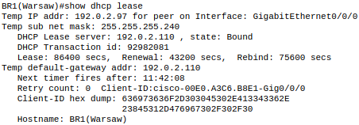

*Figure 2: `show dhcp lease` on BR1 (Warsaw). Address 192.0.2.97, default gateway 192.0.2.110.*

Munich (BR2) and The Vault already have static default routes from Sprint 1 (to 193.136.60.150 and 203.0.113.1 respectively), so they need no change.

**Oporto**

```
ip route 0.0.0.0 0.0.0.0 209.165.200.158
```

**BR1 (Warsaw)**

```
ip route 0.0.0.0 0.0.0.0 192.0.2.110
```

### 1.2 Multilayer switches

Every MLS needs `ip routing` and a default route towards its router, so traffic for unknown destinations leaves the site.

**Oporto.** Each MLS points to the HQ end of its point-to-point link:

| Device | Next hop     | Link                        |
| ------ | ------------ | --------------------------- |
| MLS1   | 10.42.59.193 | HQ Gig0/0 (10.42.59.192/30) |
| MLS2   | 10.42.59.197 | HQ Gig0/1 (10.42.59.196/30) |

```
! MLS1
ip routing
ip route 0.0.0.0 0.0.0.0 10.42.59.193

! MLS2
ip routing
ip route 0.0.0.0 0.0.0.0 10.42.59.197
```

**Warsaw.** MLS3 is the only switch connected to BR1. MLS4 and MLS5 reach it through the transit VLANs, as in Sprint 1 (Table 2.17):

| Device | Next hop     | Link                            |
| ------ | ------------ | ------------------------------- |
| MLS3   | 172.23.69.82 | BR1 Gig0/0 (172.23.69.80/30)    |
| MLS4   | 172.23.69.85 | MLS3 VLAN 100 (172.23.69.84/30) |
| MLS5   | 172.23.69.89 | MLS3 VLAN 101 (172.23.69.88/30) |

```
! MLS3
ip routing
ip route 0.0.0.0 0.0.0.0 172.23.69.82

! MLS4
ip routing
ip route 0.0.0.0 0.0.0.0 172.23.69.85

! MLS5
ip routing
ip route 0.0.0.0 0.0.0.0 172.23.69.89
```

### 1.3 Verification

The default routes were verified on every router and multilayer switch with `show ip route`, and with pings that can only succeed if the default route is used.

#### Oporto (HQ router)

The routing table shows the gateway of last resort 209.165.200.158 (`S*`), the same gateway received from DHCP. The links to MLS1 and MLS2 (10.42.59.192/30 and 10.42.59.196/30) and the three GRE tunnel subnets (section 2) are directly connected.

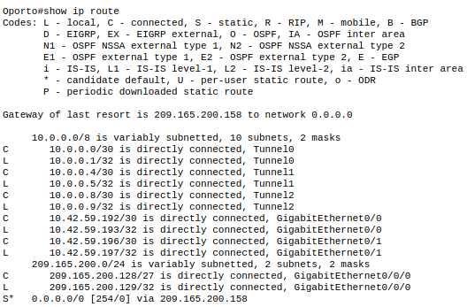

*Figure 3: `show ip route` on Oporto. The default route points to 209.165.200.158, the DHCP gateway.*

The interface summary shows the HQ ends of the MLS links (Gig0/0 10.42.59.193 and Gig0/1 10.42.59.197) and the DHCP address on Gig0/0/0 (209.165.200.129), all up/up.

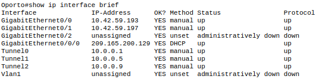

*Figure 4: `show ip interface brief` on Oporto.*

Oporto reaches the service provider gateway and the Internet (`www.google.com` resolves to 8.8.8.8), and both MLS link partners (10.42.59.194 on the MLS1 link and 10.42.59.198 on the MLS2 link).

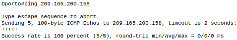

*Figure 5: `ping 209.165.200.158` (service provider gateway), 5/5.*

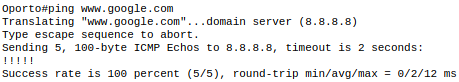

*Figure 6: `ping www.google.com`, 5/5.*

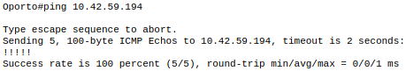

*Figure 7: `ping 10.42.59.194` (MLS1 link), 5/5.*

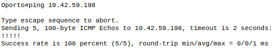

*Figure 8: `ping 10.42.59.198` (MLS2 link), 5/5.*

#### BR1 (Warsaw router)

The routing table shows the gateway of last resort 192.0.2.110 (`S*`), the DHCP gateway, together with the route to the Warsaw LANs (172.23.68.0/23 via 172.23.69.81) from Sprint 1. BR1 reaches its service provider gateway, the Internet, and the MLS3 end of the 172.23.69.80/30 link.

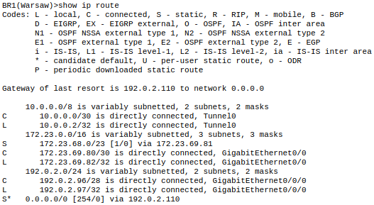

*Figure 9: `show ip route` on BR1. The default route points to 192.0.2.110, the DHCP gateway.*

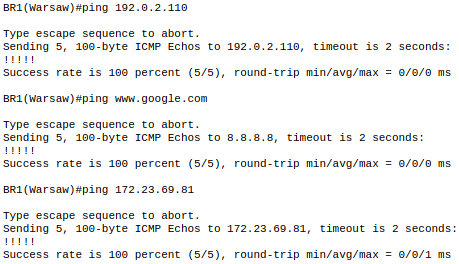

*Figure 10: pings from BR1 to 192.0.2.110 (service provider gateway), www.google.com and 172.23.69.81 (MLS3), all 5/5.*

#### Multilayer switches

Each MLS shows a default route `S* 0.0.0.0/0 [1/0]` through its next hop. The test pings go to the public address of the site router (209.165.200.129 for Oporto, 192.0.2.97 for BR1). That address is not on any network connected to the switch, so a successful reply shows that packets leave through the default route.

The MLSs are not tested against the service provider gateways: their packets carry private source addresses and the provider has no route back to them, which only changes once NAT/PAT is configured.

**MLS1.** Default route via 10.42.59.193 (HQ Gig0/0). Pings to the HQ end of the link and to Oporto's public address succeed.

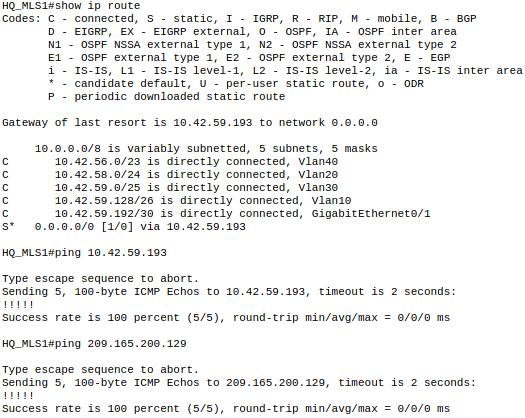

*Figure 11: `show ip route`, `ping 10.42.59.193` and `ping 209.165.200.129` on MLS1.*

**MLS2.** Default route via 10.42.59.197 (HQ Gig0/1). Pings to the HQ end of the link and to Oporto's public address succeed.


*Figure 12: `show ip route`, `ping 10.42.59.197` and `ping 209.165.200.129` on MLS2.*

**MLS3.** Default route via 172.23.69.82 (BR1 Gig0/0). Pings to BR1 on the link and to BR1's public address succeed.

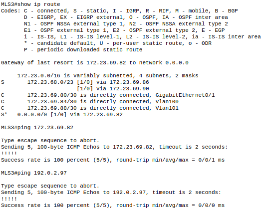

*Figure 13: `show ip route`, `ping 172.23.69.82` and `ping 192.0.2.97` on MLS3.*

**MLS4.** Default route via 172.23.69.85 (MLS3, VLAN 100). The traceroute to BR1's public address goes through MLS3 (172.23.69.85) and then reaches BR1 (172.23.69.82).


*Figure 14: `show ip route`, `ping 172.23.69.85`, `ping 192.0.2.97` and `traceroute 192.0.2.97` on MLS4.*

**MLS5.** Default route via 172.23.69.89 (MLS3, VLAN 101). The traceroute to BR1's public address goes through MLS3 (172.23.69.89) and then reaches BR1 (172.23.69.82).

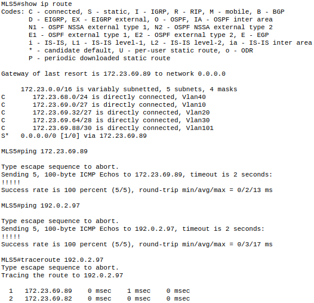

*Figure 15: `show ip route`, `ping 172.23.69.89`, `ping 192.0.2.97` and `traceroute 192.0.2.97` on MLS5.*

## 2. GRE Configuration

### 2.1 Design

Three GRE tunnels connect Oporto to each remote site. The tunnel source and destination are the public addresses of the routers' Internet interfaces, and the tunnel interfaces carry the private /30 networks. The three /30 subnets were taken from the first available blocks of 10.0.0.0/8:

| Link                | Subnet      | Oporto side | Remote side       | Oporto interface |
| ------------------- | ----------- | ----------- | ----------------- | ---------------- |
| Oporto to Warsaw    | 10.0.0.0/30 | 10.0.0.1    | 10.0.0.2 (BR1)    | Tunnel0          |
| Oporto to Munich    | 10.0.0.4/30 | 10.0.0.5    | 10.0.0.6 (BR2)    | Tunnel1          |
| Oporto to The Vault | 10.0.0.8/30 | 10.0.0.9    | 10.0.0.10 (Vault) | Tunnel2          |

These ranges do not overlap with any address space assigned to the team (10.42.56.0/22, 172.23.68.0/23, 192.186.166.0/23, 10.31.111.0/24).

**Tunnel endpoints (public addresses):**

| Router       | Interface | Public IP       | Assignment |
| ------------ | --------- | --------------- | ---------- |
| Oporto       | Gig0/0/0  | 209.165.200.129 | DHCP       |
| BR1 (Warsaw) | Gig0/0/0  | 192.0.2.97      | DHCP       |
| BR2 (Munich) | Gig0/0/0  | 193.136.60.147  | Static     |
| Vault        | Gig0/0/0  | 203.0.113.2     | Static     |

### 2.2 Network addressing table

| Network          | Mask                  | Network address | Broadcast | First host | Last host |
| ---------------- | --------------------- | --------------- | --------- | ---------- | --------- |
| Oporto to Warsaw | 255.255.255.252 (/30) | 10.0.0.0        | 10.0.0.3  | 10.0.0.1   | 10.0.0.2  |
| Oporto to Munich | 255.255.255.252 (/30) | 10.0.0.4        | 10.0.0.7  | 10.0.0.5   | 10.0.0.6  |
| Oporto to Vault  | 255.255.255.252 (/30) | 10.0.0.8        | 10.0.0.11 | 10.0.0.9   | 10.0.0.10 |

### 2.3 Interface addressing table

| Device | Interface | IP address | Mask | Purpose                 |
| ------ | --------- | ---------- | ---- | ----------------------- |
| Oporto | Tunnel0   | 10.0.0.1   | /30  | GRE tunnel to Warsaw    |
| Oporto | Tunnel1   | 10.0.0.5   | /30  | GRE tunnel to Munich    |
| Oporto | Tunnel2   | 10.0.0.9   | /30  | GRE tunnel to The Vault |
| BR1    | Tunnel0   | 10.0.0.2   | /30  | GRE tunnel to Oporto    |
| BR2    | Tunnel0   | 10.0.0.6   | /30  | GRE tunnel to Oporto    |
| Vault  | Tunnel0   | 10.0.0.10  | /30  | GRE tunnel to Oporto    |

### 2.4 Configuration

Each tunnel is built the same way: a tunnel interface is created, given an address from its /30, and bound to a source interface and a destination address. GRE over IPv4 is the default tunnel mode, set explicitly with `tunnel mode gre ip`. Both ends of every tunnel must be configured, with source and destination mirrored.

**Oporto (HQ)**

```
interface Tunnel0
 ip address 10.0.0.1 255.255.255.252
 tunnel source GigabitEthernet0/0/0
 tunnel destination 192.0.2.97
 tunnel mode gre ip
 no shutdown
!
interface Tunnel1
 ip address 10.0.0.5 255.255.255.252
 tunnel source GigabitEthernet0/0/0
 tunnel destination 193.136.60.147
 tunnel mode gre ip
 no shutdown
!
interface Tunnel2
 ip address 10.0.0.9 255.255.255.252
 tunnel source GigabitEthernet0/0/0
 tunnel destination 203.0.113.2
 tunnel mode gre ip
 no shutdown
```

**BR1 (Warsaw)**

```
interface Tunnel0
 ip address 10.0.0.2 255.255.255.252
 tunnel source GigabitEthernet0/0/0
 tunnel destination 209.165.200.129
 tunnel mode gre ip
 no shutdown
```

**BR2 (Munich)**

```
interface Tunnel0
 ip address 10.0.0.6 255.255.255.252
 tunnel source GigabitEthernet0/0/0
 tunnel destination 209.165.200.129
 tunnel mode gre ip
 no shutdown
```

**The Vault**

```
interface Tunnel0
 ip address 10.0.0.10 255.255.255.252
 tunnel source GigabitEthernet0/0/0
 tunnel destination 209.165.200.129
 tunnel mode gre ip
 no shutdown
```

### 2.5 Verification

**Interface status on Oporto.** All three tunnels are up/up with their addresses, and the routing table shows each tunnel subnet as directly connected:


*Figure 16: `show ip interface brief` on Oporto. Tunnel0, Tunnel1 and Tunnel2 are up/up with 10.0.0.1, 10.0.0.5 and 10.0.0.9.*

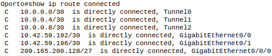

*Figure 17: `show ip route connected` on Oporto. 10.0.0.0/30, 10.0.0.4/30 and 10.0.0.8/30 are connected to Tunnel0, Tunnel1 and Tunnel2.*

**Tunnel details.** `show interfaces tunnel 0/1/2` confirms the correct source, destination and encapsulation:

| Tunnel  | Source                     | Destination    | Protocol/transport |
| ------- | -------------------------- | -------------- | ------------------ |
| Tunnel0 | 209.165.200.129 (Gig0/0/0) | 192.0.2.97     | GRE/IP             |
| Tunnel1 | 209.165.200.129 (Gig0/0/0) | 193.136.60.147 | GRE/IP             |
| Tunnel2 | 209.165.200.129 (Gig0/0/0) | 203.0.113.2    | GRE/IP             |

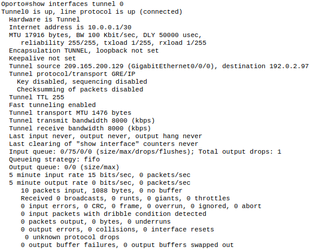

*Figure 18: `show interfaces tunnel 0` on Oporto (to Warsaw). Address 10.0.0.1/30, destination 192.0.2.97.*

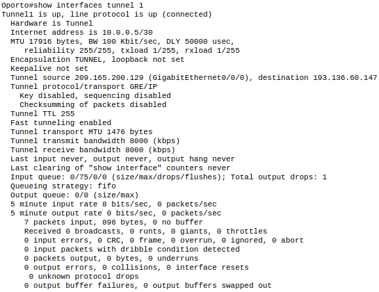

*Figure 19: `show interfaces tunnel 1` on Oporto (to Munich). Address 10.0.0.5/30, destination 193.136.60.147.*

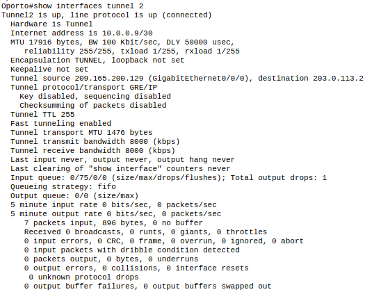

*Figure 20: `show interfaces tunnel 2` on Oporto (to The Vault). Address 10.0.0.9/30, destination 203.0.113.2.*

No keepalive is configured, so up/up only shows that the local interface is enabled and the source is valid. It does not prove the far end is reachable. The end-to-end pings below are the real test.

**End-to-end tests from Oporto:**

| Test                            | Result     |
| ------------------------------- | ---------- |
| `ping 10.0.0.2` (Warsaw tunnel) | 5/5 (100%) |
| `ping 10.0.0.6` (Munich tunnel) | 5/5 (100%) |
| `ping 10.0.0.10` (Vault tunnel) | 5/5 (100%) |

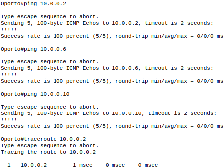

*Figure 21: pings from Oporto to the three remote tunnel addresses and `traceroute 10.0.0.2`.*

The traceroute shows a single hop, 10.0.0.2. From Oporto the tunnel behaves as a direct point-to-point link, even though the packets cross the Internet encapsulated in GRE.

**Remote end of each tunnel.** On BR1, BR2 and the Vault, Tunnel0 is up/up with its address from the /30, uses the router's own public address as source and Oporto's 209.165.200.129 as destination, and the transport is GRE/IP. A ping to the Oporto end of the tunnel succeeds from each of them (BR1 to 10.0.0.1, BR2 to 10.0.0.5, Vault to 10.0.0.9).

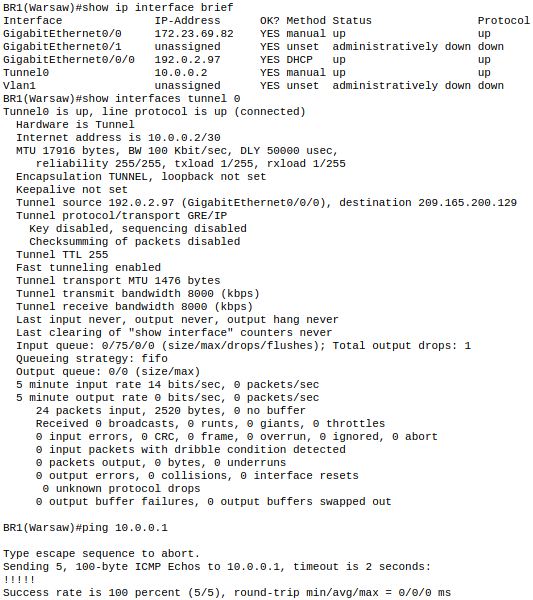

*Figure 22: `show ip interface brief`, `show interfaces tunnel 0` and `ping 10.0.0.1` on BR1 (Warsaw).*

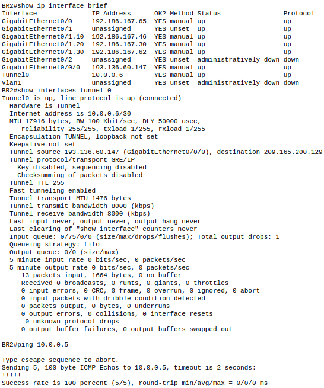

*Figure 23: `show ip interface brief`, `show interfaces tunnel 0` and `ping 10.0.0.5` on BR2 (Munich).*

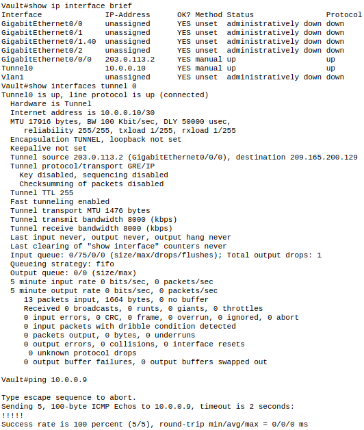

*Figure 24: `show ip interface brief`, `show interfaces tunnel 0` and `ping 10.0.0.9` on The Vault router.*

### 3. OSPF

#### 3.1 OSPF Configuration

To configure OSPF in Oporto and Warsaw, we did the following:
- Started an OSPF process with ID *1* on every router and MLS in both locations. The process ID is only locally significant, but using the same value everywhere keeps the configuration consistent.
- Manually defined a *router-id* on each device, instead of letting OSPF choose one from the interface addresses. This makes each router easy to identify in the neighbour tables and the OSPF database, and keeps the ID stable if interfaces change:
    - Oporto: *RT Oporto* 1.1.1.1, *MLS1* 1.1.1.2 and *MLS2* 1.1.1.3;
    - Warsaw: *RT Warsaw* 2.2.2.1, *MLS3* 2.2.2.2, *MLS4* 2.2.2.3 and *MLS5* 2.2.2.4.
- Advertised the tunnel network between Oporto and Warsaw (*10.0.0.0/30*) in *area 0*, the backbone area, since it interconnects both sites.
- Advertised the point-to-point links between each router and its MLSs in *area 0* as well, extending the backbone into each site.
- Advertised Oporto's local networks (VLANs 10, 20, 30 and 40) in *area 1* and Warsaw's local networks in *area 2*.

With this design, the MLSs that hold both backbone links and local networks act as *Area Border Routers (ABRs)*: *MLS1* and *MLS2* in Oporto, and *MLS4* and *MLS5* in Warsaw. *MLS3* only has links in area 0, acting as a backbone router that connects *RT Warsaw* to *MLS4* and *MLS5*. Splitting each site into its own area keeps the link-state database smaller and means topology changes inside one site do not trigger SPF recalculations in the other.

The wildcard masks used in the *network* commands are the inverse of each subnet mask. For example, *0.0.0.3* matches a /30 link and *0.0.1.255* matches the /23 network of the USERS VLAN.

- RT Oporto

```
router ospf 1
 router-id 1.1.1.1
 network 10.42.59.192 0.0.0.3 area 0
 network 10.42.59.196 0.0.0.3 area 0
 network 10.0.0.0 0.0.0.3 area 0
```

- HQ_MLS1

```
router ospf 1
 router-id 1.1.1.2
 network 10.42.59.192 0.0.0.3 area 0
 network 10.42.59.128 0.0.0.63 area 1
 network 10.42.58.0 0.0.0.255 area 1
 network 10.42.59.0 0.0.0.127 area 1
 network 10.42.56.0 0.0.1.255 area 1
```

- HQ_MLS2

```
router ospf 1
 router-id 1.1.1.3
 network 10.42.59.196 0.0.0.3 area 0
 network 10.42.59.128 0.0.0.63 area 1
 network 10.42.58.0 0.0.0.255 area 1
 network 10.42.59.0 0.0.0.127 area 1
 network 10.42.56.0 0.0.1.255 area 1
```

- RT Warsaw

```
router ospf 1
 router-id 2.2.2.1
 network 172.23.69.80 0.0.0.3 area 0
 network 10.0.0.0 0.0.0.3 area 0
```

- Warsaw_MLS3

```
router ospf 1
 router-id 2.2.2.2
 network 172.23.69.80 0.0.0.3 area 0
 network 172.23.69.84 0.0.0.3 area 0
 network 172.23.69.88 0.0.0.3 area 0
```

- Warsaw_MLS4

```
router ospf 1
 router-id 2.2.2.3
 network 172.23.69.84 0.0.0.3 area 0
 network 172.23.69.0 0.0.0.31 area 2
 network 172.23.69.32 0.0.0.31 area 2
 network 172.23.69.64 0.0.0.15 area 2
 network 172.23.68.0 0.0.0.255 area 2
```

- Warsaw_MLS5

```
router ospf 1
 router-id 2.2.2.4
 network 172.23.69.88 0.0.0.3 area 0
 network 172.23.69.0 0.0.0.31 area 2
 network 172.23.69.32 0.0.0.31 area 2
 network 172.23.69.64 0.0.0.15 area 2
 network 172.23.68.0 0.0.0.255 area 2
```

To confirm that OSPF was correctly configured, the following tests were carried out:

- On *RT Oporto*, we ran the command *show ip ospf neighbor* to check that adjacencies were formed with *MLS1*, *MLS2* and, through the tunnel, with *RT Warsaw*:

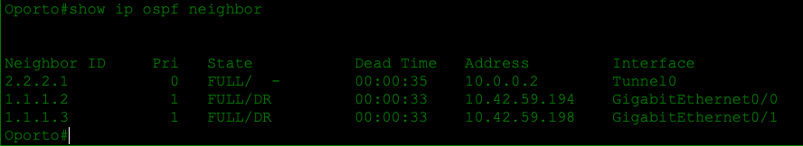

All neighbours are in the *FULL* state, identified by the router-ids configured above.

- On *RT Warsaw*, we ran the same command to confirm the adjacencies with *MLS3* and *RT Oporto*:

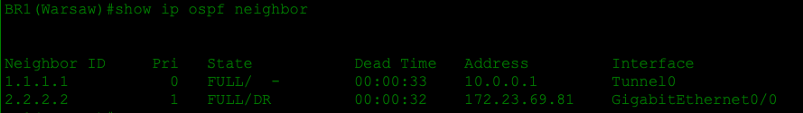

- On *RT Oporto*, we ran *show ip route ospf* to verify that Warsaw's networks were being learned:

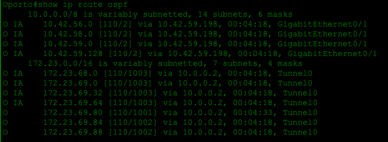

Warsaw's local networks appear as *O IA* (inter-area) routes, which is the expected result, since they belong to area 2 and are advertised into the backbone by *MLS4* and *MLS5*.

- On one of the ABRs, we ran *show ip ospf* to confirm that it is participating in both areas:

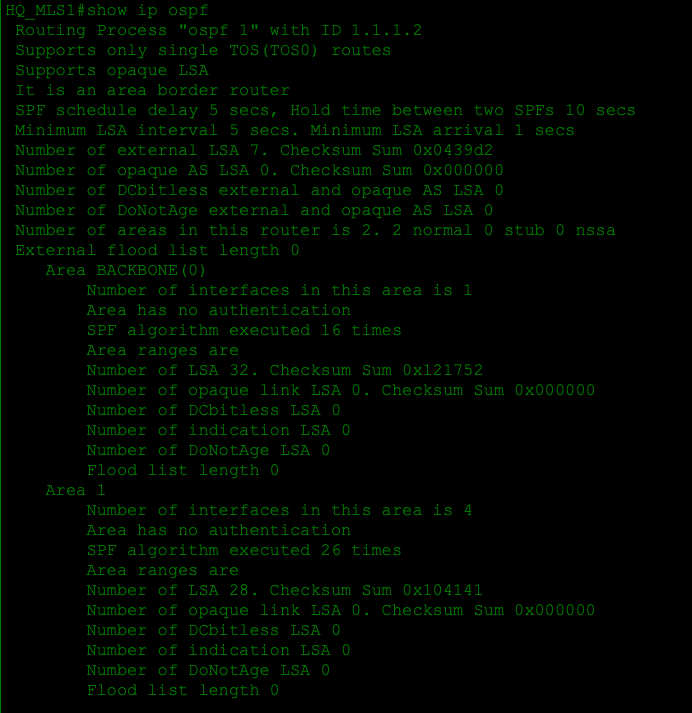

The output identifies the device as an *area border router* with interfaces in area 0 and in its local area.

#### 3.2 Connectivity Tests

- Oporto to Warsaw

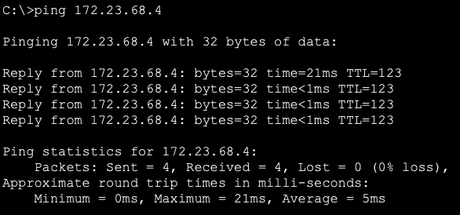

As is presented, connectivity between the hosts in Oporto and Warsaw was achieved through the OSPF backbone.

### 4. EIGRP + Redistribution

#### 4.1 EIGRP Configuration

To configure EIGRP between Oporto, Munich and the Vault, we did the following:
- Started an EIGRP process with *autonomous system number 1* on *RT Oporto (HQ)*, *BR2 Munich*, *Campus1 Munich* and the *Vault*. Unlike the OSPF process ID, the AS number must match on all routers, otherwise they do not form neighbour relationships.
- On *RT Oporto*, advertised the tunnel networks towards Munich (*10.0.0.4/30*) and towards the Vault (*10.0.0.8/30*).
- On *BR2 Munich*, advertised the tunnel network towards Oporto, Munich's local networks and the link towards *Campus1 Munich* (*192.186.167.64/30*).
- On *Campus1 Munich*, advertised the link towards *BR2 Munich* and the campus local network (*192.186.166.0/24*).
- On the *Vault*, advertised the tunnel network towards Oporto.

As in OSPF, the *network* commands include a wildcard mask, so only the intended interfaces take part in EIGRP, instead of the whole classful network.

- RT Oporto (HQ)

```
router eigrp 1
 network 10.0.0.4 0.0.0.3
 network 10.0.0.8 0.0.0.3
```

- BR2 Munich

```
router eigrp 1
 network 10.0.0.4 0.0.0.3
 network 192.186.167.32 0.0.0.15
 network 192.186.167.0 0.0.0.31
 network 192.186.167.48 0.0.0.15
 network 192.186.167.64 0.0.0.3
```

- Campus1 Munich

```
router eigrp 1
 network 192.186.167.64 0.0.0.3
 network 192.186.166.0 0.0.0.255
```

- Vault

```
router eigrp 1
 network 10.0.0.8 0.0.0.3
```

To confirm that EIGRP was correctly configured, the following tests were carried out:

- On *RT Oporto*, we ran the command *show ip eigrp neighbors* to check that neighbour relationships were formed with *BR2 Munich* and the *Vault* through the tunnel interfaces:

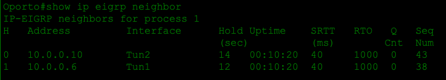

- On *BR2 Munich*, we ran the same command to confirm the adjacencies with *RT Oporto* and *Campus1 Munich*:

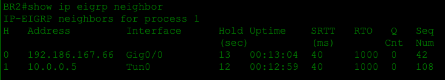

- On *RT Oporto*, we ran *show ip route eigrp* to verify that Munich's networks were being learned:

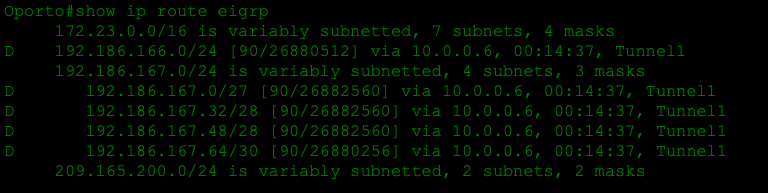

Munich's networks appear in the routing table with the code *D*, meaning they were learned through EIGRP.

#### 4.2 Route Redistribution

At this point, *RT Oporto* is the only device running both OSPF and EIGRP, so it knows every network, but the routing domains are still isolated from each other: Warsaw does not know how to reach Munich or the Vault, and vice versa. To achieve full connectivity, we configured mutual redistribution on *RT Oporto*:

```
router ospf 1
 redistribute eigrp 1 subnets
!
router eigrp 1
 redistribute ospf 1 metric 10000 1 255 1 1500
!
```

In this section, we did the following:
- Inside the OSPF process, redistributed the routes learned through EIGRP. The *subnets* keyword makes OSPF include the subnetted networks, instead of only classful networks, which would leave most of Munich's routes out.
- Inside the EIGRP process, redistributed the routes learned through OSPF. Since OSPF uses cost and EIGRP uses a composite metric, the two cannot be converted directly, so a *seed metric* had to be defined. Without it, the redistributed routes would be considered unreachable. The values used are, in order:
    - *Bandwidth*: 10000 kbps;
    - *Delay*: 1;
    - *Reliability*: 255;
    - *Load*: 1;
    - *MTU*: 1500 bytes.

This way, *RT Oporto* acts as an *Autonomous System Boundary Router (ASBR)* in OSPF, advertising the EIGRP networks into the OSPF domain, while advertising the OSPF networks to the EIGRP neighbours.

To confirm that redistribution was working, the following tests were carried out:

- On *RT Warsaw*, we ran the command *show ip route ospf 1 | include E2* to verify that Munich's and the Vault's networks were being learned:

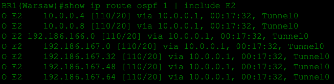

These networks appear as *O E2* routes, meaning they are external routes injected into OSPF by an ASBR, in this case *RT Oporto*.

- On *BR2 Munich*, we ran the command *show ip route eigrp* to verify that Oporto's and Warsaw's networks were being learned:

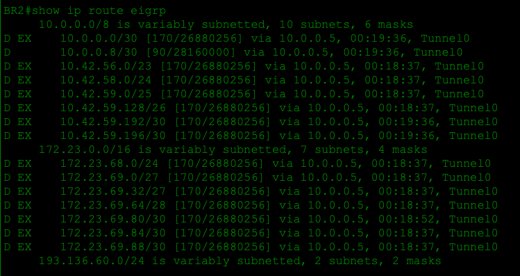

These networks appear as *D EX* routes, meaning they are external routes redistributed into EIGRP.

#### 4.3 Connectivity Tests

- Oporto HR to Munich USERS

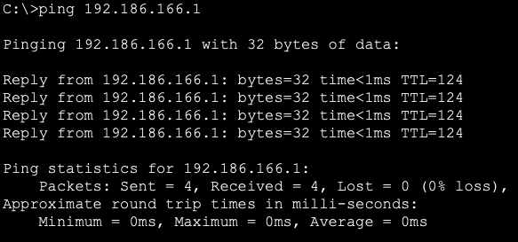

- Warsaw USERS to Munich ACCOUNTING

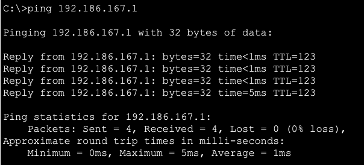

- Munich (BR2 STAFF) to Munich (Campus1 Users)

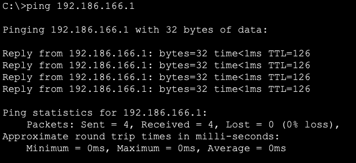

- Warsaw HR to the Vault

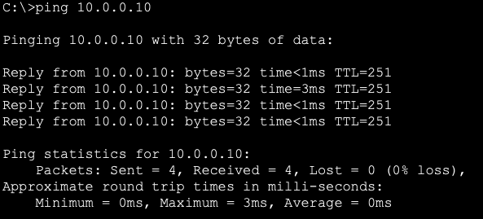

As is presented, connectivity between hosts in all locations was achieved.

## 5. PAT Configuration

### 5.1 Design

The users' networks use private addresses, which cannot be routed on the Internet. To let every user reach the Internet, PAT (Port Address Translation, NAT overload) was configured on each edge router that has local users. All inside hosts share the single public address of the router's Internet interface; the router tells the sessions apart by the source port.

| Router       | Inside interfaces         | Outside interface | Inside networks (ACL)                                                 | Public address         |
| ------------ | ------------------------- | ----------------- | --------------------------------------------------------------------- | ---------------------- |
| Oporto (HQ)  | Gig0/0, Gig0/1 (to MLSs)  | Gig0/0/0          | 10.42.56.0/22 (`10.42.56.0 0.0.3.255`)                              | 209.165.200.129 (DHCP) |
| BR1 (Warsaw) | Gig0/0 (to MLS3)          | Gig0/0/0          | 172.23.68.0/23 (`172.23.68.0 0.0.1.255`)                            | 192.0.2.97 (DHCP)      |
| BR2 (Munich) | Gig0/0, Gig0/1.10/.20/.30 | Gig0/0/0          | 192.186.0.0/16 (`192.186.0.0 0.0.255.255`), covers 192.186.166.0/23 | 193.136.60.147         |

Design decisions:

- **`interface ... overload` instead of a NAT pool.** Each site has only one public address, and on Oporto and Warsaw that address is learned from DHCP and can change. Referencing the interface makes the router always translate to whatever address the interface currently has.
- **A standard ACL selects which source addresses are translated.** On Oporto and Warsaw it matches exactly the site's address block. On Munich it matches 192.186.0.0/16, which includes the whole Munich block (192.186.166.0/23).
- **Traffic between branches is not translated.** NAT only happens when a packet goes from an `ip nat inside` interface out of an `ip nat outside` interface. Traffic for Oporto, Warsaw, Munich and the Vault is routed (OSPF/EIGRP) through the tunnel interfaces, which are neither inside nor outside, so it keeps its private source addresses end to end. The GRE packets themselves are generated by the router with its public address as source, so they are not matched by the NAT ACL either.
- **The Vault** has no user networks (its LAN interface is not in use), so it needs no PAT.

### 5.2 Configuration

**Oporto (HQ)**

```
access-list 1 permit 10.42.56.0 0.0.3.255
!
interface GigabitEthernet0/0
 ip nat inside
interface GigabitEthernet0/1
 ip nat inside
interface GigabitEthernet0/0/0
 ip nat outside
!
ip nat inside source list 1 interface GigabitEthernet0/0/0 overload
```

**BR1 (Warsaw)**

```
access-list 1 permit 172.23.68.0 0.0.1.255
!
interface GigabitEthernet0/0
 ip nat inside
interface GigabitEthernet0/0/0
 ip nat outside
!
ip nat inside source list 1 interface GigabitEthernet0/0/0 overload
```

**BR2 (Munich)**

Munich's PAT also covers the Campus1 USERS network (192.186.166.0/24): its traffic enters BR2 on Gig0/0, which is an inside interface, and Campus1 has a default route to BR2.

```
access-list 10 permit 192.186.0.0 0.0.255.255
!
interface GigabitEthernet0/0
 ip nat inside
interface GigabitEthernet0/1.10
 ip nat inside
interface GigabitEthernet0/1.20
 ip nat inside
interface GigabitEthernet0/1.30
 ip nat inside
interface GigabitEthernet0/0/0
 ip nat outside
!
ip nat inside source list 10 interface GigabitEthernet0/0/0 overload
```

### 5.3 Verification

In each site, one host pinged `www.google.com`, and `show ip nat translations` was then run on that site's router. In the translation table:

- *Inside local* is the host's private address, as it is inside the site.
- *Inside global* is the router's public address that replaces it on the Internet.
- *Outside local / Outside global* is the destination, 8.8.8.8 (Google's DNS/web server).
- The number after the colon is the port (UDP) or the ICMP identifier. It is what lets many hosts share one public address.

Packet Tracer removes ICMP translations a few seconds after the ping ends, so some tables only show the DNS (UDP port 53) entry created when the host resolved `www.google.com`.

**Oporto.** Oporto-STAFF (10.42.59.131) receives 4/4 replies from 8.8.8.8. On the Oporto router, the DNS query of this host appears translated from 10.42.59.131:1025 to the public address 209.165.200.129:1025.

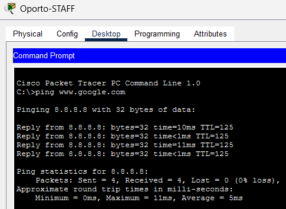

*`ping www.google.com` from Oporto-STAFF, 4/4 replies.*

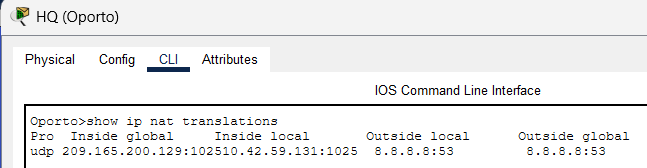

*`show ip nat translations` on Oporto. UDP (DNS) entry: inside local 10.42.59.131:1025 → inside global 209.165.200.129:1025, destination 8.8.8.8:53.*

**Warsaw.** Warsaw-USERS receives 4/4 replies from 8.8.8.8. On BR1, the ICMP packets of the host (172.23.69.68) are translated to BR1's public address 192.0.2.97, each with its own ICMP identifier (1, 2, 3).

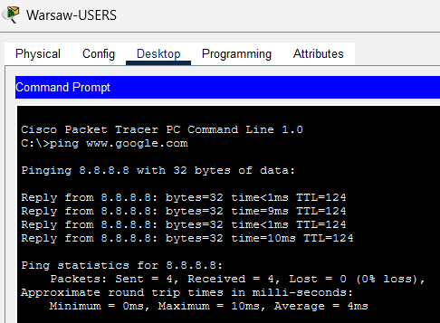

 *`ping www.google.com` from Warsaw-USERS, 4/4 replies.*

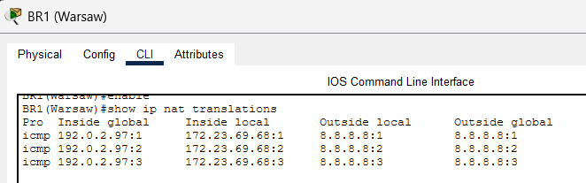

*`show ip nat translations` on BR1. ICMP entries: inside local 172.23.69.68 → inside global 192.0.2.97, destination 8.8.8.8.*

**Munich.** Munich-STAFF (192.186.167.33) receives 4/4 replies from 8.8.8.8. BR2 shows the four ICMP echo requests (identifiers 1–4) and the DNS query (UDP 1025 → 53), all translated to BR2's public address 193.136.60.147.

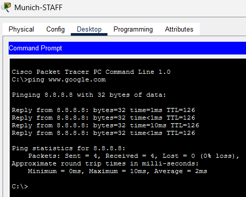

 *`ping www.google.com` from Munich-STAFF, 4/4 replies.*

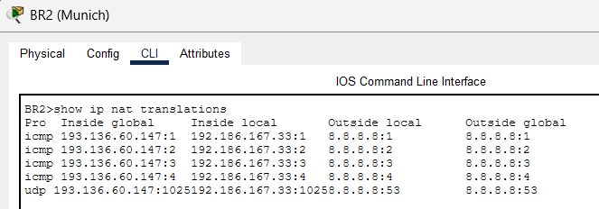

*`show ip nat translations` on BR2. Four ICMP entries and one UDP (DNS) entry: inside local 192.186.167.33 → inside global 193.136.60.147.*

In all three sites, the private source address of the host never reaches the Internet: the service provider only sees the router's public address. The pings between sites in section 6.4 (Figure 33) still work after PAT, and these do not create entries in the NAT table, because traffic sent through the GRE tunnels is not translated.

**PAT with the ACLs applied.** The tests above were repeated after the ACLs (section 7) were applied, and they still succeed. The `OUTSIDE-IN` ACL on each Internet interface is checked *before* the outside-to-inside translation, so the replies are still addressed to the router's public address. They are permitted by the "return traffic for PAT" entries: ICMP echo-reply, ttl-exceeded and unreachable, TCP `established`, and DNS replies from 8.8.8.8.

## 6. Port Security Configuration

### 6.1 Requirements and design

After the security breach reported by the Warsaw branch (unauthorised personnel used a free switch port), port security was enabled on the access switches of every branch. The requirement is to shut the interface down if more than 2 MAC addresses are registered on it, for VLANs 10, 20, 30 and 40, and to register every MAC address that is recognised.

The same template was applied to every user access port. Other Layer 2 protections from the TP2 class were applied at the same time:

| Command                                         | Purpose                                                                                       |
| ----------------------------------------------- | --------------------------------------------------------------------------------------------- |
| `switchport mode access`                      | Port security only works on static access ports; it also disables DTP on the port.            |
| `switchport port-security`                    | Enables port security on the interface.                                                       |
| `switchport port-security maximum 2`          | At most 2 MAC addresses may be learned (e.g. a PC and an IP phone).                           |
| `switchport port-security mac-address sticky` | Every MAC learned is written to the running configuration ("registers every MAC recognised"). |
| `switchport port-security violation shutdown` | A 3rd MAC puts the port in *err-disabled* state (this is the default mode, set explicitly). |
| `spanning-tree portfast`                      | Hosts are forwarding immediately instead of waiting through listening/learning.               |
| `spanning-tree bpduguard enable`              | If a switch is plugged into the port (a BPDU is received), the port is err-disabled.          |

Unused ports are shut down and moved to the *BLACKHOLE* VLAN 99, so a cable plugged into a free port has no link and, if re-enabled by mistake, lands in a VLAN with no gateway. Trunks use `switchport nonegotiate` and the dedicated *NATIVE* VLAN 50 instead of VLAN 1.

### 6.2 Port allocation

| Switch       | Site             | Trunk / uplink                   | VLAN 10 | VLAN 20  | VLAN 30   | VLAN 40   | Blackhole (VLAN 99, shut)    |
| ------------ | ---------------- | -------------------------------- | ------- | -------- | --------- | --------- | ---------------------------- |
| SW7          | Munich (BR2)     | Gig0/1 trunk to BR2              | Fa0/1-5 | Fa0/6-10 | Fa0/11-15 | -         | Fa0/16-24, Gig0/2            |
| SW8          | Munich (Campus1) | Gig0/1 access VLAN 40 to Campus1 | -       | -        | -         | Fa0/1-24  | Gig0/2                       |
| SW3-SW6      | Warsaw           | Fa0/1-2 trunks to MLS4/MLS5      | Fa0/3-5 | Fa0/6-10 | Fa0/11-15 | Fa0/16-20 | Fa0/21-24, Gig0/1-2          |
| SW1-SW2      | Oporto           | Fa0/3-4 trunks to MLS1/MLS2      | Fa0/5-8 | Fa0/9-12 | Fa0/13-16 | Fa0/17-20 | Fa0/1-2, Fa0/21-24, Gig0/1-2 |
| Vault Switch | The Vault        | Gig0/1 to Vault router           | -       | -        | -         | -         | Fa0/1-24, Gig0/2             |

The Vault has no user VLANs (10-40) and no hosts, so all of its access ports are quarantined in VLAN 99.

### 6.3 Configuration (Munich)

**SW7 (BR2 LAN: STAFF, ACCOUNTING, HR)**

DHCP snooping and Dynamic ARP Inspection were also enabled for the user VLANs. The trunk to BR2 is trusted, because the DHCP server (BR2) and the gateways are reached through it.

```
ip dhcp snooping
ip dhcp snooping vlan 10,20,30
no ip dhcp snooping information option
ip arp inspection vlan 10,20,30
!
interface GigabitEthernet0/1
 description Uplink to BR2 Router
 switchport mode trunk
 switchport nonegotiate
 switchport trunk native vlan 50
 switchport trunk allowed vlan 10,20,30,50
 ip dhcp snooping trust
 ip arp inspection trust
!
interface range FastEthernet0/1 - 5
 description ACCESS PORTS - STAFF
 switchport mode access
 switchport access vlan 10
 switchport port-security
 switchport port-security maximum 2
 switchport port-security mac-address sticky
 switchport port-security violation shutdown
 spanning-tree portfast
 spanning-tree bpduguard enable
!
! (same block for Fa0/6-10 in VLAN 20 and Fa0/11-15 in VLAN 30)
!
interface range FastEthernet0/16 - 24, GigabitEthernet0/2
 description NOT IN USE - BLACKHOLE
 switchport mode access
 switchport access vlan 99
 shutdown
```

**SW8 (Campus1 LAN: USERS)**

```
ip dhcp snooping
ip dhcp snooping vlan 40
no ip dhcp snooping information option
ip arp inspection vlan 40
!
interface GigabitEthernet0/1
 description Access Link to Campus1 Router
 switchport mode access
 switchport access vlan 40
 ip dhcp snooping trust
 ip arp inspection trust
!
interface range FastEthernet0/1 - 24
 description ACCESS PORTS - USERS
 switchport mode access
 switchport access vlan 40
 switchport port-security
 switchport port-security maximum 2
 switchport port-security mac-address sticky
 switchport port-security violation shutdown
 spanning-tree portfast
 spanning-tree bpduguard enable
!
interface GigabitEthernet0/2
 description NOT IN USE - BLACKHOLE
 switchport mode access
 switchport access vlan 99
 shutdown
```

The same port-security template was applied to the access ports of Warsaw (SW3-SW6) and Oporto (SW1-SW2). In Warsaw and the Vault, DHCP snooping and DAI were left disabled: in Packet Tracer they dropped legitimate ARP traffic on those switches.

### 6.4 Verification

**Sticky MAC learned.** After each host generated traffic, its MAC address was added to the running configuration as a sticky entry, e.g. on SW7:

```
interface FastEthernet0/1
 switchport port-security mac-address sticky 0002.4A4C.5281   (Munich-STAFF)
interface FastEthernet0/6
 switchport port-security mac-address sticky 0001.4225.E90C   (Munich-ACCOUNTING)
interface FastEthernet0/11
 switchport port-security mac-address sticky 00D0.9790.1391   (Munich-HR)
```

**SW7: port-security status and learned addresses.** `show port-security` lists the 15 user ports (Fa0/1-15), all with *MaxSecureAddr* 2 and *Security Action* Shutdown. The three ports with a host connected (Fa0/1, Fa0/6 and Fa0/11) have *CurrentAddr* 1, and no port has violations. `show port-security address` shows the three addresses as *SecureSticky*, each in the VLAN of its port: 10 (STAFF), 20 (ACCOUNTING) and 30 (HR).

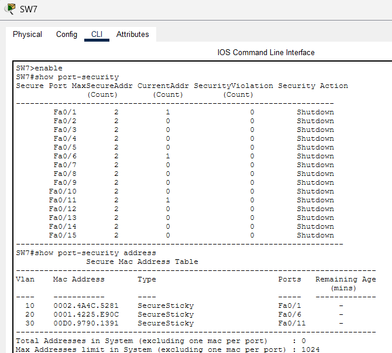

 *`show port-security` and `show port-security address` on SW7.*

**SW8: detail of one port.** On the Campus1 switch, Fa0/1 (Munich-USERS) has port security *Enabled*, status *Secure-up*, violation mode *Shutdown* and a maximum of 2 MAC addresses. One address was learned as sticky (0030.F2AB.C1E1, in VLAN 40), and the violation count is 0.

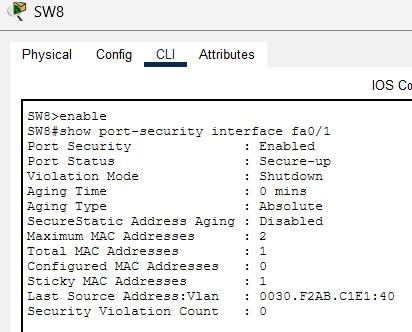

*`show port-security interface fa0/1` on SW8.*

**Behaviour on a violation.** Figures 31 and 32 show the maximum of 2 MAC addresses and the *Shutdown* violation mode. If a third MAC address appears on one of these ports (for example, someone connects a hub or a small switch), the port goes to the *err-disabled* state and the violation counter increases. An administrator must then remove the extra devices and re-enable the port with `shutdown` / `no shutdown`.

**Hosts still work behind port security.** With port security active, Munich-STAFF still reaches the other sites: it pings Munich-USERS on Campus1 (192.186.166.1) and Oporto-STAFF (10.42.59.131), with 4/4 replies in both cases. Its Internet access was shown in Figure 29.

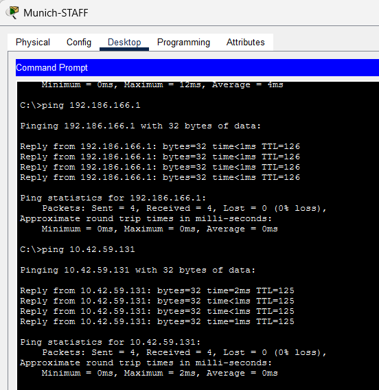

*pings from Munich-STAFF to Munich-USERS (192.186.166.1) and to Oporto-STAFF (10.42.59.131).*

**Unused ports.** `show interfaces status` on SW7 shows the three hosts as *connected* on Fa0/1, Fa0/6 and Fa0/11 (VLANs 10, 20 and 30). The other user ports are *notconnect*, so they are still enabled and ready for new hosts. The unused ports Fa0/16-24 and Gig0/2 are *disabled* in VLAN 99, and the uplink Gig0/1 is a *trunk*.

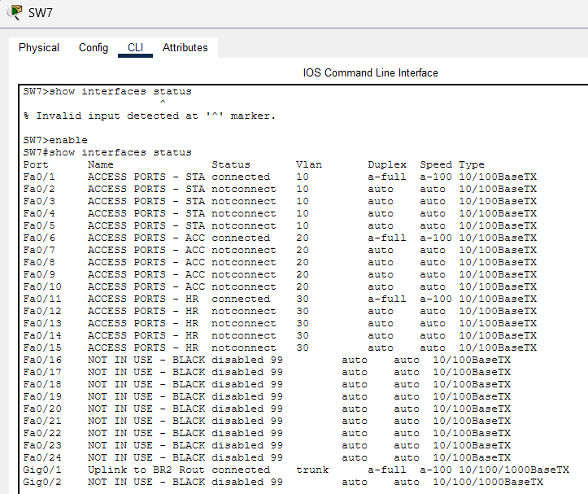

*`show interfaces status` on SW7.*


## 7. Access Control Lists (ACLs)

### 7.1 Requirements

The project statement defines three requirements for the ACLs, to be applied, as far as possible, on all the routers of Oporto, Warsaw and Munich:

- **Block spoofing:** internal spoofing, coming from the local networks, and external spoofing, in traffic coming in from the Internet.
- **Protect the routers:** all traffic addressed to the routers must be blocked, except the traffic the current features need in order to work (GRE, DHCP, OSPF, EIGRP, among others).
- **Allow transit traffic:** the remaining traffic passing through the routers must be allowed.

The Vault is not mentioned in this requirement, so its router was left without ACLs.

### 7.2 Design

#### 7.2.1 Placement

We used **named extended ACLs**, always applied **inbound**. This way, each packet is checked as soon as it reaches the router, before it is routed or translated, and the name of each ACL says where the traffic comes from. For example, *MLS1-IN* filters what enters *RT Oporto* coming from *MLS1*.

| Router | Interface | ACL | Traffic filtered |
|---|---|---|---|
| RT Oporto (HQ) | Gi0/0 | MLS1-IN | From MLS1 (Oporto LAN) |
| RT Oporto (HQ) | Gi0/1 | MLS2-IN | From MLS2 (Oporto LAN) |
| RT Oporto (HQ) | Gi0/0/0 | OUTSIDE-IN | From the Internet |
| RT Warsaw (BR1) | Gi0/0 | MLS3-IN | From MLS3 (Warsaw LAN) |
| RT Warsaw (BR1) | Gi0/0/0 | OUTSIDE-IN | From the Internet |
| BR2 Munich | Gi0/1.10 | STAFF-IN | From VLAN 10 (STAFF) |
| BR2 Munich | Gi0/1.20 | ACCOUNTING-IN | From VLAN 20 (ACCOUNTING) |
| BR2 Munich | Gi0/1.30 | HR-IN | From VLAN 30 (HR) |
| BR2 Munich | Gi0/0 | CAMPUS1-IN | From Campus1 |
| BR2 Munich | Gi0/0/0 | OUTSIDE-IN | From the Internet |
| Campus1 Munich | Gi0/1 | USERS-IN | From VLAN 40 (USERS) |
| Campus1 Munich | Gi0/0 | BR2-IN | From BR2 |

**Packet Tracer limitation:** in Packet Tracer 8.2.2, the *Tunnel* interfaces only accept the *ip address* command, so it is not possible to apply an ACL to a GRE tunnel. Traffic that arrives at a router through a tunnel cannot be filtered there. To work around this, the traffic is filtered at its source:

- Each LAN ACL blocks traffic addressed to **any** router of Oporto, Warsaw and Munich, and not only to the local router. A host in Warsaw cannot reach *RT Oporto* through the tunnel either, because its packet is dropped as soon as it enters *RT Warsaw*.
- Each LAN ACL only accepts the local addresses as source. A spoofed packet never reaches a tunnel.

#### 7.2.2 Internal anti-spoofing

Each ACL facing a local network only accepts, as source, the addresses that really exist behind that interface. Any other source is dropped by the final *deny ip any any*:

| ACL | Accepted sources |
|---|---|
| MLS1-IN, MLS2-IN | 10.42.56.0/22 (Oporto) |
| MLS3-IN | 172.23.68.0/23 (Warsaw) |
| STAFF-IN | 192.186.167.32/28 |
| ACCOUNTING-IN | 192.186.167.0/27 |
| HR-IN | 192.186.167.48/28 |
| CAMPUS1-IN | 192.186.166.0/24 (USERS) and Campus1 itself (192.186.167.66) |
| USERS-IN | 192.186.166.0/24 |

On *Campus1*, the *BR2-IN* ACL does the opposite check: the USERS network (192.186.166.0/24) only exists behind Gi0/1, so a packet with that source arriving from *BR2* is spoofed and is dropped.

#### 7.2.3 External anti-spoofing

The *OUTSIDE-IN* ACLs drop any packet coming from the Internet whose source address could not be legitimate:

| Source | Reason |
|---|---|
| 0.0.0.0/8 | "This network", never a valid source on the Internet |
| 10.0.0.0/8 | Private (RFC 1918); also covers Oporto and the tunnels |
| 127.0.0.0/8 | Loopback |
| 169.254.0.0/16 | Link-local |
| 172.16.0.0/12 | Private (RFC 1918); also covers Warsaw |
| 192.168.0.0/16 | Private (RFC 1918) |
| 192.186.166.0/23 | Munich's own address space |
| 224.0.0.0/4 | Multicast, never a valid source |
| 240.0.0.0/4 | Reserved |
| The router's own public IP | A packet from the Internet can never come from the router itself |

The documentation ranges 192.0.2.0/24 and 203.0.113.0/24 are normally blocked as well. In this topology, however, they are the real Service Provider addresses of Warsaw (192.0.2.97) and of the Vault (203.0.113.2). Blocking them would drop the GRE tunnels, so they were not included.

#### 7.2.4 Traffic allowed to the routers

Before blocking the traffic addressed to the routers, each ACL explicitly allows what the current features need:

| Feature | Where | ACL line | Why it is needed |
|---|---|---|---|
| DHCP client | HQ and BR1, OUTSIDE-IN | `permit udp host <SP gateway> eq 67 any eq 68` | Gi0/0/0 gets its public IP from the SP by DHCP |
| DHCP server | BR2 (VLANs 10/20/30) and Campus1 (USERS) | `permit udp host 0.0.0.0 eq 68 host 255.255.255.255 eq 67` | Requests from clients that still have no address |
| DHCP server | Same | `permit udp <VLAN> eq 68 host <gateway> eq 67` | Renewals, sent by unicast to the gateway |
| OSPF | HQ (MLS1-IN, MLS2-IN) and BR1 (MLS3-IN) | `permit ospf host <MLS> any` | OSPF neighbours on the router-MLS links |
| EIGRP | BR2 (CAMPUS1-IN) and Campus1 (BR2-IN) | `permit eigrp host <neighbour> any` | EIGRP neighbours on the BR2-Campus1 link |
| GRE | OUTSIDE-IN of all three sites | `permit gre host <peer public IP> host <own public IP>` | The tunnels end on the public IP. OSPF and EIGRP over the tunnels travel inside GRE, so this line also lets them through. |
| PAT return and the router's own traffic | OUTSIDE-IN of all three sites | `echo-reply`, `ttl-exceeded`, `unreachable`, `tcp ... established`, `udp host 8.8.8.8 eq 53` | See below |

The routing protocols and GRE are only accepted from the legitimate neighbour, never from any address.

**PAT return traffic:** on the outside interface, the inbound ACL is processed **before** the NAT translation from outside to inside. The reply to a PC that went out through PAT therefore reaches the ACL with the router's public IP as destination, and would be dropped by the line that blocks traffic to the router. For this reason, the OUTSIDE-IN ACLs allow, to the public IP:

- ICMP *echo-reply*, *ttl-exceeded* and *unreachable*: ping and traceroute replies;
- TCP *established*: segments with the ACK or RST flag. A new connection opened from the Internet starts with a SYN without ACK, so it does not match this line and is dropped;
- DNS replies from 8.8.8.8, the DNS server given to the hosts by DHCP.

The same lines also cover the router's own traffic, such as `ping www.google.com` from the CLI.

#### 7.2.5 Structure of each ACL

- **LAN ACLs:** routing protocol and DHCP lines first, then *deny* to the IPs of all routers of Oporto, Warsaw and Munich, then *permit* for the local sources, and finally *deny ip any any*.
- **OUTSIDE-IN ACLs:** DHCP (only on HQ and BR1), then *deny* for the spoofed sources, then *permit* for GRE and the PAT return, then *deny* for anything else addressed to the router's IPs, and finally *permit ip any any*, which allows all remaining transit traffic.

The router addresses blocked in the LAN ACLs are:

| Address | Router |
|---|---|
| 10.0.0.0/29 (10.0.0.1, .2, .5, .6) and 10.0.0.9 | Tunnel endpoints on HQ, BR1 and BR2 |
| 209.165.200.129 | RT Oporto, public IP |
| 10.42.59.193, 10.42.59.197 | RT Oporto, links to MLS1 and MLS2 |
| 192.0.2.97 | RT Warsaw, public IP |
| 172.23.69.82 | RT Warsaw, link to MLS3 |
| 193.136.60.147 | BR2, public IP |
| 192.186.167.64/30 | BR2-Campus1 link |
| 192.186.167.30, .46, .62 | BR2, VLAN gateways |
| 192.186.166.254 | Campus1, USERS gateway |

The Vault tunnel endpoint (10.0.0.10) was left out, since the Vault is outside the scope of this requirement.

### 7.3 Configuration

The full configuration of every router is in *ConfigFiles_Sprint2/ACLs.txt*. As an example, these are the ACLs of *RT Oporto*, the router where the three tunnels end:

- RT Oporto, LAN side (MLS2-IN is the same, with 10.42.59.198 in the OSPF line)

```
ip access-list extended MLS1-IN
 remark OSPF from MLS1
 permit ospf host 10.42.59.194 any
 remark Block traffic addressed to any Oporto, Warsaw or Munich router
 deny ip any 10.0.0.0 0.0.0.7
 deny ip any host 10.0.0.9
 deny ip any host 209.165.200.129
 deny ip any host 10.42.59.193
 deny ip any host 10.42.59.197
 deny ip any host 192.0.2.97
 deny ip any host 172.23.69.82
 deny ip any host 193.136.60.147
 deny ip any 192.186.167.64 0.0.0.3
 deny ip any host 192.186.167.30
 deny ip any host 192.186.167.46
 deny ip any host 192.186.167.62
 deny ip any host 192.186.166.254
 remark Internal anti-spoofing: only Oporto sources may enter
 permit ip 10.42.56.0 0.0.3.255 any
 deny ip any any
!
interface GigabitEthernet0/0
 ip access-group MLS1-IN in
interface GigabitEthernet0/1
 ip access-group MLS2-IN in
```

- RT Oporto, Internet side

```
ip access-list extended OUTSIDE-IN
 remark DHCP replies from the SP (Gi0/0/0 is a DHCP client)
 permit udp host 209.165.200.158 eq 67 any eq 68
 remark External anti-spoofing: private, reserved and internal sources
 deny ip 0.0.0.0 0.255.255.255 any
 deny ip 10.0.0.0 0.255.255.255 any
 deny ip 127.0.0.0 0.255.255.255 any
 deny ip 169.254.0.0 0.0.255.255 any
 deny ip 172.16.0.0 0.15.255.255 any
 deny ip 192.168.0.0 0.0.255.255 any
 deny ip 192.186.166.0 0.0.1.255 any
 deny ip 224.0.0.0 15.255.255.255 any
 deny ip 240.0.0.0 15.255.255.255 any
 deny ip host 209.165.200.129 any
 remark GRE from the tunnel peers (Warsaw, Munich, Vault)
 permit gre host 192.0.2.97 host 209.165.200.129
 permit gre host 193.136.60.147 host 209.165.200.129
 permit gre host 203.0.113.2 host 209.165.200.129
 remark Return traffic for PAT and for the router itself
 permit icmp any host 209.165.200.129 echo-reply
 permit icmp any host 209.165.200.129 ttl-exceeded
 permit icmp any host 209.165.200.129 unreachable
 permit tcp any host 209.165.200.129 established
 permit udp host 8.8.8.8 eq 53 host 209.165.200.129
 remark Block everything else addressed to this router
 deny ip any host 209.165.200.129
 deny ip any host 10.42.59.193
 deny ip any host 10.42.59.197
 deny ip any host 10.0.0.1
 deny ip any host 10.0.0.5
 deny ip any host 10.0.0.9
 remark Allow all remaining transit traffic
 permit ip any any
!
interface GigabitEthernet0/0/0
 ip access-group OUTSIDE-IN in
```

The other routers follow the same structure. The differences are:

| Router | ACL | Differences from RT Oporto |
|---|---|---|
| RT Warsaw | MLS3-IN | OSPF from 172.23.69.81; source 172.23.68.0/23 |
| RT Warsaw | OUTSIDE-IN | DHCP from 192.0.2.110; GRE only from 209.165.200.129; protects 192.0.2.97, 172.23.69.82 and 10.0.0.2 |
| BR2 | STAFF-IN, ACCOUNTING-IN, HR-IN | DHCP server lines instead of OSPF; source is the VLAN network |
| BR2 | CAMPUS1-IN | EIGRP from 192.186.167.66; sources 192.186.166.0/24 and 192.186.167.66 |
| BR2 | OUTSIDE-IN | No DHCP line (static public IP); GRE only from 209.165.200.129; protects 193.136.60.147, 10.0.0.6, 192.186.167.65 and the three VLAN gateways |
| Campus1 | USERS-IN | DHCP server lines; source 192.186.166.0/24 |
| Campus1 | BR2-IN | EIGRP from 192.186.167.65; drops the USERS network as source; protects 192.186.167.66 and 192.186.166.254; allows everything else |

### 7.4 Tests

The tests were carried out one router at a time, in the order BR2, Campus1, BR1 and RT Oporto. RT Oporto was the last one because a mistake in its OUTSIDE-IN would drop all three tunnels. After applying each ACL, we checked that the routing neighbours stayed up, that transit traffic still passed and that traffic addressed to the routers was dropped. The match counters of *show access-lists* show which line handled each packet.

| Test | Expected | Result |
|---|---|---|
| OSPF neighbours after the ACLs (HQ and BR1) | All in FULL, including over Tunnel0 | OK |
| EIGRP neighbours after the ACLs (HQ, BR2 and Campus1) | Tun1, Tun2 and the BR2-Campus1 link up | OK |
| GRE on the HQ | Matches on the three *permit gre* lines | OK |
| DHCP client: *shutdown* / *no shutdown* on Gi0/0/0 of HQ and BR1 | Public IP renewed; tunnels and neighbours come back | OK |
| DHCP server: PCs in Munich get an address | Matches on the DHCP lines of STAFF-IN and USERS-IN | OK |
| Ping between PCs of the three sites | Reply | OK |
| PAT: PC ping to 8.8.8.8 and www.google.com | Reply; *echo-reply* and *udp 53* counters go up | OK |
| Router's own traffic: `ping www.google.com` on HQ and BR1 | !!!!! | OK |
| Ping from a PC to the IPs of its own and of remote routers | Dropped | OK (matches on the corresponding *deny* lines) |

- Oporto PC: transit allowed, routers blocked

<p align="center">
  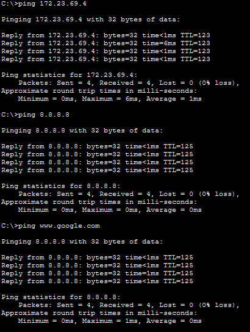
  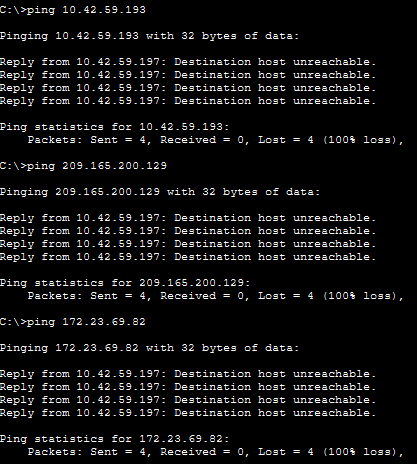
</p>

On the left, the pings to a PC in Warsaw (172.23.69.4) and to the Internet (8.8.8.8 and www.google.com) get a reply. On the right, the pings to *RT Oporto* (10.42.59.193 and 209.165.200.129) and to *RT Warsaw* (172.23.69.82) fail. The *Destination host unreachable* message is sent by *RT Oporto* (10.42.59.197) because the packet was dropped by the ACL.

- RT Oporto: MLS1-IN counters

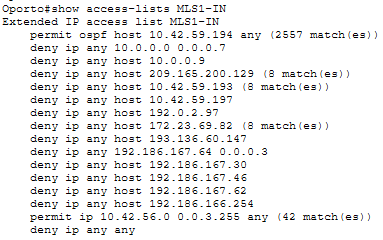

The blocked pings appear as matches on the corresponding *deny* lines (10.42.59.193, 209.165.200.129 and 172.23.69.82), while the traffic to the other sites and to the Internet matched the *permit* for the Oporto sources. The *permit ospf* line keeps the OSPF neighbour with *MLS1*.

- RT Oporto: OUTSIDE-IN counters

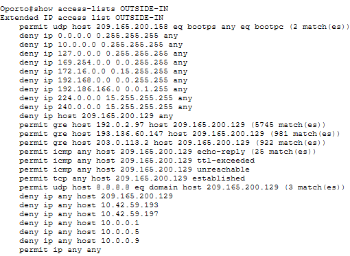

The three *permit gre* lines have matches, one per tunnel peer, so the tunnels to Warsaw, Munich and the Vault, and the OSPF and EIGRP traffic inside them, pass through the ACL. The DHCP line has matches from the renewal test. The *echo-reply* and *udp 53* lines went up with the PC's ping to 8.8.8.8 and www.google.com, which shows that the PAT return traffic is allowed. No packet matched the anti-spoofing lines, as expected, because no spoofed traffic was generated.

- Warsaw PC: transit allowed, routers blocked

<p align="center">
  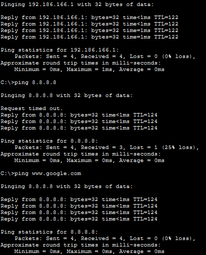
  
</p>

On the left, the pings from Warsaw-STAFF to a PC in Munich (192.186.166.1) and to the Internet (8.8.8.8 and www.google.com) get a reply. On the right, the pings to *RT Warsaw* (172.23.69.82), to the tunnel endpoint of *RT Oporto* (10.0.0.1) and to *BR2* (193.136.60.147) fail. The *Destination host unreachable* message is sent by *RT Warsaw* (172.23.69.82) because the packet was dropped by MLS3-IN. The first ping to 8.8.8.8 timed out while the ARP and the PAT translation were being set up, which is normal in Packet Tracer.

- RT Warsaw: MLS3-IN counters


The blocked pings appear as matches on the corresponding *deny* lines, while the traffic to the other sites and to the Internet matched the *permit* for the Warsaw sources. The *permit ospf* line keeps the OSPF neighbour with *MLS3*.

- RT Warsaw: OUTSIDE-IN counters


The *permit gre* line has matches, so the tunnel to *RT Oporto*, and the OSPF traffic inside it, pass through the ACL. The DHCP line has matches from the renewal test below, and the *echo-reply* and *udp 53* lines went up with the PC's pings to the Internet, which shows that the PAT return traffic is allowed.

- RT Warsaw: DHCP client renewal


After *shutdown* / *no shutdown* on Gi0/0/0, the interface gets 192.0.2.97 again from the SP, and the OSPF neighbour over Tunnel0 comes back to FULL. This shows that the DHCP line of OUTSIDE-IN is working.

- Munich PC (STAFF, behind BR2): transit allowed, routers blocked

<p align="center">
  
  
</p>

On the left, the pings from Munich-STAFF to a PC in Warsaw (172.23.69.4) and to the Internet (8.8.8.8 and www.google.com) get a reply. On the right, the pings to its own gateway on *BR2* (192.186.167.46), to the public IP of *BR2* (193.136.60.147) and to the tunnel endpoint of *RT Oporto* (10.0.0.5) fail. The *Destination host unreachable* message is sent by *BR2* (192.186.167.46) because the packet was dropped by STAFF-IN.

- BR2 Munich: STAFF-IN counters


The DHCP request line has matches from the PC getting its address from *BR2*, and the blocked pings appear as matches on the corresponding *deny* lines. The traffic to the other sites and to the Internet matched the *permit* for the STAFF sources. ACCOUNTING-IN and HR-IN have the same structure.

- BR2 Munich: OUTSIDE-IN counters


The *permit gre* line has matches, so the tunnel to *RT Oporto*, and the EIGRP traffic inside it, pass through the ACL. The *echo-reply* and *udp 53* lines went up with the PC's pings to the Internet, which shows that the PAT return traffic is allowed. *BR2* has a static public IP, so this ACL has no DHCP line.

- Campus1 Munich: USERS PC blocked from the routers


The pings from Munich-USERS to its gateway on *Campus1* (192.186.166.254), to *BR2* (192.186.167.65) and to *RT Oporto* (10.0.0.1) fail. The *Destination host unreachable* message is sent by *Campus1* (192.186.166.254) because the packet was dropped by USERS-IN. The transit traffic from this PC was already shown in the tests from Oporto and Warsaw, which reach it at 192.186.166.1.

- Campus1 Munich: USERS-IN and BR2-IN counters


On USERS-IN, the DHCP request line and the local traffic have matches, and the blocked pings appear on the corresponding *deny* lines. On BR2-IN, the *permit eigrp* line keeps the EIGRP neighbour with *BR2*, and the transit traffic coming from the other sites matches the final *permit ip any any*.

### 7.5 Limitations

- **No ACLs on the tunnels:** Packet Tracer does not allow ACLs on Tunnel interfaces, so the protection against traffic arriving through the tunnels depends on the LAN ACLs of the other sites. This works because all the sources are filtered at their origin.
- **Stateless ACLs:** the PAT return is allowed by protocol, not by session. Apart from DNS from 8.8.8.8, UDP replies from the Internet to the hosts are not allowed. Allowing them per session would require stateful filtering, such as reflexive ACLs or a zone-based firewall, which is outside the scope of this sprint.
- **Router addresses are listed one by one:** if any router IP changes, the LAN ACLs of all sites must be updated.
- **The Vault is not covered**, since the requirement only names Oporto, Warsaw and Munich.
